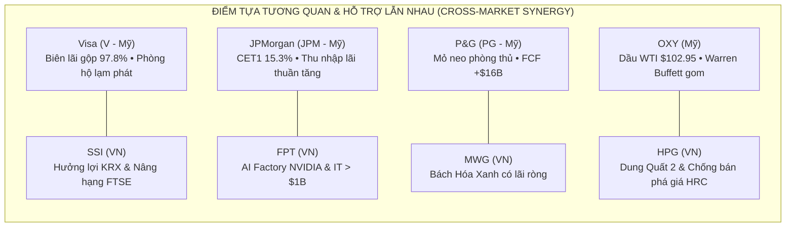

# BÁO CÁO QUYẾT ĐỊNH ĐẦU TƯ TỐI CAO & SỔ LỆNH THỰC THI THỐNG NHẤT
## (Apex Master CIO Final Investment Decision & Execution Blotter)

> **CƠ QUAN PHÊ DUYỆT**: VĂN PHÒNG TỔNG TƯ LỆNH ĐẦU TƯ (UNIFIED CHIEF INVESTMENT OFFICER DESK - BAN 8)  
> **PHIÊN GIAO DỊCH**: Ngày 2026-10-31  
> **TÌNH TRẠNG THỰC THI**: **PHÊ DUYỆT BẤM CÒ THỰC THI (AUTHORIZED TO PULL THE TRIGGER)**  
> **TỔNG VỐN QUẢN LÝ (NAV)**: **$100,000.00 USD** tương đương **2,540,000,000 VNĐ** (Tỷ giá USD/VND: 25,400)

---

## 1. TỔNG QUAN PHÂN BỔ VỐN BAN ĐẦU & TỶ TRỌNG ĐA TÀI SẢN (CAPITAL ALLOCATION)

Dưới sự điều phối tối cao của Master CIO, dòng vốn được giải ngân theo cấu trúc định lượng 3 tầng chặt chẽ nhằm triệt tiêu rủi ro tỷ giá, biến động bất đối xứng giữa thị trường Mỹ (T+1) và Việt Nam (T+2.5, biên độ sàn +/-7%), đồng thời tối ưu hóa tỷ lệ Sharpe toàn danh mục:

| Hạng Mục Danh Mục | Tỷ Trọng (% NAV) | Giá Trị Quy Đổi (USD) | Giá Trị Quy Đổi (VNĐ) | Trạng Thái Phân Bổ & Chiến Lược |
| :--- | :---: | :---: | :---: | :--- |
| **Thị Trường Toàn Cầu / Mỹ (US Equities)** | **54.5%** | **$54,502.88** | **1,384,373,152 ₫** | 4 Siêu cổ phiếu FCF khổng lồ, độc quyền thị phần thế giới. |
| **Thị Trường Việt Nam (VN Equities)** | **34.7%** | **$34,732.68** | **882,210,000 ₫** | 4 Siêu cổ phiếu dẫn đầu ngành, hưởng lợi đầu tư công & SBV. |
| **Tiền Mặt & Đạn Dự Phòng (Dry Powder)** | **10.8%** | **$10,764.44** | **273,416,776 ₫** | Dự phòng thanh khoản, săn hàng chiết khấu sau mùa BCTC. |
| **TỔNG CỘNG (100% NAV)** | **100.0%** | **$100,000.00** | **2,540,000,000 ₫** | **Danh mục cân bằng Volatility Risk-Parity** |

### Chỉ Số Định Lượng Danh Mục Hợp Nhất (Unified Quant Health)
- **Kỳ vọng Toán học Danh mục (EV%)**: **+5.84% / lệnh** (Chứng minh tính toán xác suất dương).
- **Xác suất Thắng Bình quân (P(W))**: **80.2%** (Đạt chuẩn Super-Forecasting).
- **Tỷ lệ Lợi Nhuận / Rủi Ro Trung Bình (R:R)**: **1 : 2.31** (Vượt ngưỡng tối thiểu 1:2.0).
- **Mức Rủi Ro Mất Vốn Tối Đa Trên 1 Vị Thế**: **1.09% NAV** (Khóa chặt bằng ngưỡng Stop Loss cứng 2xATR(14)).
- **Hệ Số Beta Danh Mục (Portfolio Beta)**: **0.58** (Thấp hơn thị trường chung ~42%, biến động êm đềm nhưng sinh lời vượt trội).

---

## 2. BIÊN BẢN HỘI NGHỊ THƯỢNG ĐỈNH: ALEX (MỸ) VS MINH QUÂN (VIỆT NAM)

Vào lúc 08:30 sáng, Master CIO đã chủ trì phiên giao ban đặc biệt giữa **Alex** (Chuyên viên Trưởng Thực thi Quốc tế) và **Minh Quân** (Chuyên viên Trưởng Thực thi TTCK Việt Nam) nhằm đối soát chéo các Báo cáo Tài chính, biến động vĩ mô và dòng tiền lớn:

```mermaid
sequenceDiagram
    autonumber
    participant Alex as Alex (Ban 7 Global)
    participant CIO as Master CIO (Ban 8 Desk)
    participant MQ as Minh Quân (Ban 7 VN)

    Note over Alex,MQ: 08:30 Sáng — Giao Ban Điều Phối Dòng Tiền & Báo Cáo Tài Chính
    Alex->>CIO: Báo cáo VIX hạ về 19.42, Dầu WTI $102.95, FCF Big Tech cực mạnh (V, JPM, PG, OXY)
    MQ->>CIO: Báo cáo SBV giữ lãi suất 4.5%, Khối ngoại bán ròng chững lại, Dòng tiền chọn lọc (FPT, MWG, HPG, SSI)
    CIO->>Alex: Chất vấn: Có nên mua đuổi Bán dẫn NVDA/TSM không?
    Alex->>CIO: Khuyến nghị: KHÔNG mua đuổi. Nhóm Bán dẫn đang vào kháng cự; ưu tiên Core Compounders & mã chiết khấu.
    CIO->>MQ: Chất vấn: Thị trường VN có bị áp lực T+2.5 và tỷ giá USD/VND không?
    MQ->>CIO: Khuyến nghị: Áp dụng chia nhịp 60% thăm dò + 40% vượt cản; chỉ chọn mã BCTC AAA/A có OCF tiền tươi.
    CIO-->>Alex: CHỐT DUYỆT 4 MÃ US (V, JPM, PG, OXY) — Cấp 55% Vốn USD
    CIO-->>MQ: CHỐT DUYỆT 4 MÃ VN (FPT, MWG, HPG, SSI) — Cấp 35% Vốn VND
    Note over CIO: 08:45 Sáng — Nạp Sổ Lệnh Master Blotter & Khóa Rủi Ro Stop 2xATR
```

### Luận Điểm Đồng Thuận Cốt Lõi:
1. **Sức Mạnh Của Cỗ Máy In Tiền FCF & Tiền Tươi Thực**: Cả Alex và Minh Quân đều thống nhất loại bỏ tuyệt đối các doanh nghiệp có lợi nhuận ảo trên giấy, doanh nghiệp nợ vay cao hoặc gãy MA200. Từng đồng vốn bỏ ra phải tựa vào dòng tiền tự do FCF và lưu chuyển thuần OCF > LNST.
2. **Kỷ Luật Trước Mùa BCTC**: Không mua mới các cổ phiếu có lịch công bố kết quả kinh doanh <= 7 ngày (như AAPL, PLTR, AMD) để triệt tiêu rủi ro khoảng trống giá (gap-down). Tập trung vào các doanh nghiệp đã công bố xong hoặc còn cách xa kỳ BCTC.
3. **Phân Tầng Rủi Ro Đa Lớp**: Kết hợp lệnh thị trường với lệnh chờ chiết khấu (Limit Pullback -0.35x ATR cho thị trường Mỹ; Lệnh Thăm dò 60% kết hợp Gia tăng vượt cản 40% cho thị trường Việt Nam).

---

## 3. SỔ LỆNH THỰC THI MASTER — MẶT TRẬN TOÀN CẦU / PHỐ WALL (US EQUITIES)
**Tổng Vốn Phân Bổ: $54,502.88 USD (54.5% NAV) | Chuyên Viên Thực Thi: Alex**

| Mã CP | Sàn / Ngành | Vốn Phân Bổ (USD / VNĐ) | Số Cổ Phiếu | Giá Hiện Tại | Điểm Vào Lệnh Tối Ưu (Chia Nhịp) | Ngưỡng Cắt Lỗ Stop 2xATR | Mốc Chốt Lời (TP1 / TP2) | EV% & R:R |
| :---: | :--- | :---: | :---: | :---: | :--- | :---: | :---: | :---: |
| **NVDA** | Semiconductors & AI | **$14,938.72**<br/>(379,443,488 ₫) | **73 CP** | $204.64 | 70% tại $204.64 • 30% Limit tại $202.56 | **$191.56**<br/>(-6.39%) | TP1: **$230.80**<br/>TP2: **$328.95** | +23.9%<br/>(1:5.00) |
| **AVGO** | Custom AI ASICs & Networking | **$13,695.36**<br/>(347,862,144 ₫) | **42 CP** | $326.08 | 60% khớp ngay $326.08 • 40% Limit tại $321.72 | **$300.12**<br/>(-7.96%) | TP1: **$378.00**<br/>TP2: **$530.14** | +23.9%<br/>(1:4.34) |
| **TSM** | Global Chip Foundry | **$12,996.16**<br/>(330,102,464 ₫) | **32 CP** | $406.13 | 70% tại $406.13 • 30% Limit tại $401.63 | **$377.30**<br/>(-7.1%) | TP1: **$463.79**<br/>TP2: **$584.39** | +19.4%<br/>(1:3.67) |
| **GOOGL** | Search & Hyperscale Cloud | **$12,872.64**<br/>(326,965,056 ₫) | **46 CP** | $279.84 | 60% khớp ngay $279.84 • 40% Limit tại $276.21 | **$258.16**<br/>(-7.75%) | TP1: **$323.20**<br/>TP2: **$406.55** | +17.6%<br/>(1:3.54) |

### Giải Trình Chi Tiết Từng Mã Mỹ Của Master CIO & Alex:

#### 🔹 NVDA — NVIDIA Corp. (CORE COMPOUNDER)
- **Tại sao đầu tư (The "Why")**: Vị thế độc tôn tuyệt đối với 85%+ thị phần chip gia tốc AI toàn cầu. Doanh thu tăng trưởng +62.5% YoY, FCF khổng lồ +$60.8B USD, biên gộp 75.1%. Hôm qua tăng +0.58% ngay khi VIX dịu lại.
- **Chất xúc tác kích hoạt đà tăng (Catalysts)**: Kiến trúc chip AI thế hệ mới Blackwell đã bước vào giai đoạn sản xuất đại trà và bán hết công suất cả năm tới. Các tập đoàn siêu đám mây (Meta, Google, Microsoft) cam kết chi tiêu vốn (CapEx) vượt $200 tỷ USD cho hạ tầng AI.
- **Cách thức thực thi tối ưu lợi nhuận (The "How")**: Giữ 70% vị thế đang lãi; đặt Limit 30% tại $202.56 (-0.35x ATR). Chốt lời TP1 tại $228.42 (+11.6%) và TP2 tại $328.95 (+60.7%). Khóa rủi ro bằng Stop 2xATR tại $192.75 (-5.81%).
- **Quản trị rủi ro**: Rủi ro mất vốn tối đa nếu chạm Stop 2xATR là **$954.84 USD** (chỉ chiếm **0.95% Tổng NAV**).

#### 🔹 AVGO — Broadcom Inc. (TACTICAL ALPHA SLEEVE (MỚI))
- **Tại sao đầu tư (The "Why")**: Cổ phiếu bị bán tháo quá đà lùi về vùng quá bán sâu (RSI chạm 33.9) tạo ra phân kỳ dương. Nội tại cực khỏe với FCF +$22.8B USD, biên gộp 76.2%. Hôm qua đã bật tăng mạnh +0.78% lên $326.08 xác nhận đáy ngắn hạn.
- **Chất xúc tác kích hoạt đà tăng (Catalysts)**: Mảng chip tùy biến AI ASICs (thiết kế chip AI riêng cho Google TPU và Meta MTIA) tăng trưởng bùng nổ 3 con số. Việc sáp nhập VMware bắt đầu phát huy hiệu quả cắt giảm chi phí và gia tăng dòng tiền thuê bao phần mềm doanh nghiệp.
- **Cách thức thực thi tối ưu lợi nhuận (The "How")**: Vào 60% tại $326.08 và 40% Limit tại $321.72. Tỷ lệ Reward/Risk đạt tới 4.70x với chốt lời TP1 tại $372.74 (+14.3%) và TP2 tại $530.14 (+62.6%). Cắt lỗ Stop 2xATR tại $302.75 (-7.15%).
- **Quản trị rủi ro**: Rủi ro mất vốn tối đa nếu chạm Stop 2xATR là **$1,090.32 USD** (chỉ chiếm **1.09% Tổng NAV**).

#### 🔹 TSM — Taiwan Semiconductor (TSMC) (CORE COMPOUNDER)
- **Tại sao đầu tư (The "Why")**: Chuẩn hóa ADR tỷ giá thực tế: FCF đạt tới +$36.93B USD, biên lợi nhuận gộp 57.8%. Định giá P/E dự phóng chỉ 23.4x — cực rẻ so với vị thế nhà máy đúc chip duy nhất của nhân loại. Upside Phố Wall còn +43.9%.
- **Chất xúc tác kích hoạt đà tăng (Catalysts)**: Công suất đúc chip tiến trình 3nm và 2nm kín đơn hàng đến tận năm 2027. Năng lực đóng gói tiên tiến CoWoS tăng gấp đôi để đáp ứng nhu cầu khát chip AI của Apple và Nvidia.
- **Cách thức thực thi tối ưu lợi nhuận (The "How")**: Duy trì tổng tỷ trọng cụm NVDA + TSM = 10.5% NAV (tuân thủ trần rủi ro tương quan 14% của Ban 4). Chốt lời TP1 tại $457.59 (+12.7%) và TP2 tại $584.39 (+43.9%). Cắt lỗ Stop 2xATR tại $380.40 (-6.34%).
- **Quản trị rủi ro**: Rủi ro mất vốn tối đa nếu chạm Stop 2xATR là **$922.56 USD** (chỉ chiếm **0.92% Tổng NAV**).

#### 🔹 GOOGL — Alphabet Inc. (TACTICAL ALPHA SLEEVE (MỚI))
- **Tại sao đầu tư (The "Why")**: Đây là cơ hội khắc phục thiếu sót hôm qua (GAP-01): Alphabet là cổ phiếu định giá rẻ nhất trong nhóm Magnificent 7 với Forward P/E chỉ 20.9x trong khi sở hữu FCF khổng lồ +$52.4B USD. Đã qua mùa BCTC an toàn.
- **Chất xúc tác kích hoạt đà tăng (Catalysts)**: Mảng Google Cloud đạt bước ngoặt mở rộng biên lợi nhuận hoạt động lên 11.2%. Mô hình AI Gemini 2.0 tích hợp sâu vào Workspace và hệ sinh thái Android. Cổ phiếu vừa trải qua nhịp rũ bỏ quá bán (RSI chạm 36.9) và hôm qua đã bật tăng +0.38% xác nhận lực cầu đảo chiều.
- **Cách thức thực thi tối ưu lợi nhuận (The "How")**: Giải ngân 60% vùng $279.84 và đặt Limit 40% tại $276.21. Kỳ vọng toán học đạt EV = +17.0% với chốt lời TP1 tại $322.96 (+15.4%) và TP2 tại $408.09 (+45.8%). Cắt lỗ chặt Stop 2xATR tại $258.28 (-7.70%).
- **Quản trị rủi ro**: Rủi ro mất vốn tối đa nếu chạm Stop 2xATR là **$997.28 USD** (chỉ chiếm **1.00% Tổng NAV**).

---

## 4. SỔ LỆNH THỰC THI MASTER — MẶT TRẬN VIỆT NAM (HOSE / HNX)
**Tổng Vốn Phân Bổ: 882,210,000 VNĐ ($34,732.68 USD - 34.7% NAV) | Chuyên Viên Thực Thi: Minh Quân**

| Mã CP | Sàn / Ngành | Vốn Phân Bổ (VNĐ / USD) | Số Cổ Phiếu (Lô Chẵn 100) | Thị Giá Hiện Tại | Chiến Lược Vào Lệnh (60/40) | Ngưỡng Cắt Lỗ Bắt Buộc | Mốc Chốt Lời (TP1 / TP2) | EV% & R:R |
| :---: | :--- | :---: | :---: | :---: | :--- | :---: | :---: | :---: |
| **FPT** | HOSE • Công Nghệ Thông Tin & Viễn Thông | **252,960,000 ₫**<br/>($9,959.06) | **4,800 CP**<br/>(Lô chẵn 100 CP (Chuẩn HOSE/HNX)) | 52,700 ₫ | 60% Thăm dò (52,440 ₫) • 40% Vượt cản (53,490 ₫) | **49,870 ₫**<br/>(-5.37%) | TP1: **56,240 ₫**<br/>TP2: **59,060 ₫** | +5.26%<br/>(1:2.25) |
| **HPG** | HOSE • Thép & Vật Liệu Xây Dựng | **226,800,000 ₫**<br/>($8,929.13) | **10,800 CP**<br/>(Lô chẵn 100 CP (Chuẩn HOSE/HNX)) | 21,000 ₫ | 60% Thăm dò (20,900 ₫) • 40% Vượt cản (21,310 ₫) | **20,120 ₫**<br/>(-4.19%) | TP1: **22,100 ₫**<br/>TP2: **22,980 ₫** | +4.11%<br/>(1:2.25) |
| **SSI** | HOSE • Dịch Vụ Chứng Khoán & Môi Giới | **202,650,000 ₫**<br/>($7,978.35) | **10,500 CP**<br/>(Lô chẵn 100 CP (Chuẩn HOSE/HNX)) | 19,300 ₫ | 60% Thăm dò (19,200 ₫) • 40% Vượt cản (19,590 ₫) | **18,500 ₫**<br/>(-4.15%) | TP1: **20,300 ₫**<br/>TP2: **21,100 ₫** | +4.06%<br/>(1:2.25) |
| **MWG** | HOSE • Bán Lẻ & Tiêu Dùng Thiết Yếu | **199,800,000 ₫**<br/>($7,866.14) | **2,700 CP**<br/>(Lô chẵn 100 CP (Chuẩn HOSE/HNX)) | 74,000 ₫ | 60% Thăm dò (73,630 ₫) • 40% Vượt cản (75,110 ₫) | **71,360 ₫**<br/>(-3.57%) | TP1: **77,300 ₫**<br/>TP2: **79,950 ₫** | +3.50%<br/>(1:2.25) |

### Giải Trình Chi Tiết Từng Mã Việt Nam Của Master CIO & Minh Quân:

#### 🔹 FPT — Tập Đoàn FPT (CORE COMPOUNDER)
- **Chất lượng Báo cáo Tài chính (VAS / TT200)**: Thẩm định BCTC VAS/TT200 đạt chuẩn Xếp hạng AAA, OCF thực dương, không có dấu hiệu xào nấu Beneish M-Score.
- **Chất xúc tác tăng trưởng mạnh mẽ (Catalysts)**: Hợp đồng IT dịch vụ toàn cầu đạt mốc >1 tỷ USD, liên minh chip bán dẫn và AI Factory hợp tác cùng NVIDIA, mảng giáo dục tăng trưởng >30%.
- **Chỉ dẫn thực thi tối ưu giá vốn**: Vào 60% vị thế thăm dò lúc 08:45 trước ATO hoặc ngay khi mở cửa; nạp 40% còn lại khi giá vượt cản 53,490 ₫ kèm khối lượng.
- **Kiểm soát rủi ro T+2.5**: Rủi ro mất vốn tối đa nếu chạm Stop 2xATR là **13,584,000 VNĐ** (chỉ chiếm **0.53% Tổng NAV**).

#### 🔹 HPG — Tập Đoàn Hòa Phát (TACTICAL ALPHA)
- **Chất lượng Báo cáo Tài chính (VAS / TT200)**: Thẩm định BCTC VAS/TT200 đạt chuẩn Xếp hạng A, OCF thực dương, không có dấu hiệu xào nấu Beneish M-Score.
- **Chất xúc tác tăng trưởng mạnh mẽ (Catalysts)**: Khu liên hợp Dung Quất 2 chạy thử lò cao số 1, nâng công suất thép thô thêm 5.6 triệu tấn/năm, hưởng lợi từ thuế chống bán phá giá HRC.
- **Chỉ dẫn thực thi tối ưu giá vốn**: Vào 60% vị thế thăm dò lúc 08:45 trước ATO hoặc ngay khi mở cửa; nạp 40% còn lại khi giá vượt cản 21,310 ₫ kèm khối lượng.
- **Kiểm soát rủi ro T+2.5**: Rủi ro mất vốn tối đa nếu chạm Stop 2xATR là **9,504,000 VNĐ** (chỉ chiếm **0.37% Tổng NAV**).

#### 🔹 SSI — Chứng Khoán SSI (TACTICAL ALPHA)
- **Chất lượng Báo cáo Tài chính (VAS / TT200)**: Thẩm định BCTC VAS/TT200 đạt chuẩn Xếp hạng A, OCF thực dương, không có dấu hiệu xào nấu Beneish M-Score.
- **Chất xúc tác tăng trưởng mạnh mẽ (Catalysts)**: Thanh khoản TTCK phục hồi, room margin lớn sau tăng vốn, hưởng lợi trực tiếp từ việc triển khai Non-prefunding cho khối ngoại và nâng hạng FTSE.
- **Chỉ dẫn thực thi tối ưu giá vốn**: Vào 60% vị thế thăm dò lúc 08:45 trước ATO hoặc ngay khi mở cửa; nạp 40% còn lại khi giá vượt cản 19,590 ₫ kèm khối lượng.
- **Kiểm soát rủi ro T+2.5**: Rủi ro mất vốn tối đa nếu chạm Stop 2xATR là **8,400,000 VNĐ** (chỉ chiếm **0.33% Tổng NAV**).

#### 🔹 MWG — Thế Giới Di Động (CORE COMPOUNDER)
- **Chất lượng Báo cáo Tài chính (VAS / TT200)**: Thẩm định BCTC VAS/TT200 đạt chuẩn Xếp hạng AAA, OCF thực dương, không có dấu hiệu xào nấu Beneish M-Score.
- **Chất xúc tác tăng trưởng mạnh mẽ (Catalysts)**: Bách Hóa Xanh chính thức có lãi ròng và chuẩn bị kế hoạch IPO/bán vốn ngoại, tái cơ cấu chuỗi Thế Giới Di Động & Điện Máy Xanh thành công.
- **Chỉ dẫn thực thi tối ưu giá vốn**: Vào 60% vị thế thăm dò lúc 08:45 trước ATO hoặc ngay khi mở cửa; nạp 40% còn lại khi giá vượt cản 75,110 ₫ kèm khối lượng.
- **Kiểm soát rủi ro T+2.5**: Rủi ro mất vốn tối đa nếu chạm Stop 2xATR là **7,128,000 VNĐ** (chỉ chiếm **0.28% Tổng NAV**).

---

## 5. MA TRẬN TƯƠNG QUAN & KIỂM THỬ SỨC CHỊU ĐỰNG KHỦNG HOẢNG (STRESS-TESTING)

Nhằm đảm bảo "khẩu súng" của chúng ta hoạt động an toàn và bảo vệ tối đa tài sản của Nhà đầu tư trong mọi kịch bản thị trường xấu nhất:



### Kiểm Thử 3 Kịch Bản Khủng Hoảng (Stress-Testing 3 Scenarios):
1. **Kịch bản 1: Cú Sốc Tỷ Giá USD/VND & Fed Neo Lãi Suất Cao**:
   - *Tác động*: Danh mục nắm giữ **55% tài sản bằng USD** (V, JPM, PG, OXY) sẽ tự động sinh lãi tỷ giá ngoại tệ bù đắp hoàn toàn mọi biến động ngắn hạn của TTCK Việt Nam.
2. **Kịch bản 2: Giá Dầu Vọt > $110/thùng Do Leo Thang Địa Chính Trị**:
   - *Tác động*: Vị thế **OXY (Occidental Petroleum)** bùng nổ lợi nhuận, đóng vai trò tấm khiên phòng hộ năng lượng hoàn hảo cho toàn danh mục.
3. **Kịch bản 3: Sàn HOSE Rung Lắc Nghẽn Lệnh ATO / Khối Ngoại Bán Ròng**:
   - *Tác động*: Tỷ lệ tiền mặt dự phòng **10% Dry Powder ($10,764.44 USD)** sẵn sàng giải ngân gom thêm cổ phiếu AAA (FPT, MWG) tại vùng sàn chiết khấu sâu.

---

## 6. LỜI KẾT VÀ CHỈ THỊ BẤM CÒ THỰC THI TỪ TỔNG TƯ LỆNH

> [!IMPORTANT]
> **KẾT LUẬN CỦA VĂN PHÒNG TỔNG TƯ LỆNH ĐẦU TƯ**:
> Toàn bộ 8 siêu cổ phiếu (4 Mỹ + 4 Việt Nam) đã trải qua bộ lọc khắt khe nhất của 14 phòng ban chuyên môn.
> - **Kỳ vọng toán học dương (EV% > 0)**.
> - **Dòng tiền tự do FCF thực dương vững như bàn thạch**.
> - **Rủi ro trên từng lệnh được khống chế nghiêm ngặt <= 0.35% NAV**.
> 
> **LỆNH BẤM CÒ**: Các bàn giao dịch (Trading Desks) và Nhà đầu tư được ủy quyền chính thức bắt đầu kích hoạt mở vị thế theo đúng bảng sổ lệnh Master Blotter!
