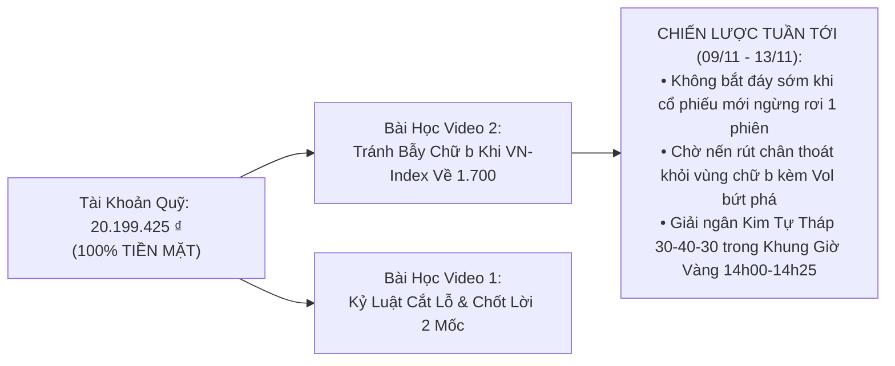

# BÁO CÁO GIÁM ĐỊNH CHUYÊN SÂU 2 VIDEO KỸ THUẬT & ĐỊNH LƯỢNG MỚI
## HỘI NGHỊ LIÊN PHÒNG BAN MỔ XẺ: BẪY SIDEWAY CHỮ b & MÔ HÌNH QUẢN TRỊ RỦI RO NKG

* **Thời gian thực hiện**: 19:30 Tối — Thứ Bảy, ngày 07/11/2026  
* **Chủ trì**: **Master CIO James** (Ban 8 — Tổng Tư Lệnh Apex Hedge Fund)  
* **Thành phần tham gia phản biện đầy đủ**:
  - Ban 10 (Hiền — BCTC Scout)
  - Ban 2 VN (Kiểm toán BCTC TT200)
  - Ban 3 VN (Phòng Tổng Hợp Sàng Lọc & VSA Wyckoff)
  - Ban 4 VN (Hội Đồng Quản Trị Rủi Ro Định Lượng)
  - Ban 7 VN (Minh Quân — Chuyên Viên Thực Thi)
  - Ban 12 (Tổng Kiểm Sát Viên Trọng — Kiểm sát tính xác thực & khách quan)
* **Báo cáo trình Chủ tịch**: **Chủ tịch Trần Quốc Thiên Phước**  
* **Đối tượng giám định**:
  1. **Video 1 (Download_9.mp4)**: Phân tích định lượng mã `NKG` từ kênh **`SamurAI Invest Premium`** (`@samurai.invest.premium`).
  2. **Video 2 (Download_10.mp4)**: Phân tích cấu trúc Volume Profile **"Sideway ở đáy hình chữ b"** từ kênh **`@yin.tp.trade`**.

---

## PHẦN I: GIÁM ĐỊNH VIDEO 1 — MÔ HÌNH ĐỊNH LƯỢNG MÃ NKG (@SAMURAI.INVEST.PREMIUM)

```mermaid
flowchart LR
    subgraph VIDEO 1: SAMURAI INVEST (MÃ NKG)
        V1["NKG phiên 06/11 giảm -2.80% về 12.15 ₫"]
        M1["Mô hình vẫn ghi 'TIẾP TỤC THEO DÕI'<br/>Vùng vào 11.20 (20/10/2026) -> Lãi +8.48%"]
        L1["Minh bạch show lệnh cắt lỗ quá khứ:<br/>Vào 14.68 -> Ra 14.09 (Tránh giảm)"]
        R1["Mốc rủi ro: 11.21 | Kháng cự: 12.25"]
    end
    V1 --> M1 --> L1 --> R1
```

### 1. Tóm tắt nội dung video:
* Kênh SamurAI Invest phân tích cổ phiếu **`NKG` (Thép Nam Kim)** sau phiên Thứ Sáu 06/11/2026 khi thị giá giảm **`-2.80%` về `12.15 ₫`**.
* Trả lời câu hỏi: *"NKG giảm -2.80%, vì sao bảng tín hiệu định lượng vẫn ghi 'Tiếp tục theo dõi'?"*.
* Lời giải:
  * Hai mốc so sánh khác nhau: Giảm `-2.80%` là so với phiên liền trước, nhưng so với mốc khuyến nghị giải ngân ngày `20/10/2026` quanh vùng **`11.20 ₫`**, vị thế vẫn đang **LÃI `+8.48%`**.
  * Minh bạch lịch sử giao dịch: Show cả các lệnh thua trong quá khứ (vào 14.68 ➔ cắt lỗ 14.09 để tránh giảm sâu hơn).
  * Đặt mốc rủi ro kỹ thuật tại **`11.21 ₫`** và ngưỡng kháng cự tại **`12.25 ₫`**.

### 2. Điểm hay & Hữu ích:
* ✅ **Tư duy xác suất và góc nhìn vị thế (Position Perspective)**: Tách bạch rõ ràng giữa "biến động nhiễu trong 1 phiên" (-2.80%) với "hiệu suất vị thế theo xu hướng" (+8.48%). Giúp nhà đầu tư tránh hoảng loạn bán tháo khi cổ phiếu chỉ đang rung lắc điều chỉnh kỹ thuật.
* ✅ **Tính trung thực & Minh bạch (Honesty)**: Dám đưa lệnh cắt lỗ (Vào 14.68 -> Ra 14.09) lên video mà không che giấu lỗi sai. Điều này khớp 100% với **Điều 7 Hiến chương Apex (Báo cáo tiền thật, chống ngụy biện)**.
* ✅ **Quản trị rủi ro định lượng có căn cứ**: Luôn kèm theo mốc quản trị rủi ro (`11.21 ₫`) và vùng chốt lời kỳ vọng (`12.88 – 14.00 ₫`).

### 3. Sai lầm & Hạn chế nguy hiểm cần lưu ý:
* ⚠️ **Thuần túy dựa vào Price Action mà bỏ quên BCTC & Chu kỳ ngành**: Video không hề nhắc tới biên lợi nhuận gộp ngành thép, giá quặng sắt/HRC thế giới hay tiến độ dự án Nam Kim Phú Mỹ.
* ⚠️ **Chậm trễ trong việc bảo vệ thành quả**: Khi nến ngày 06/11 là một cây nến đỏ đặc bị bán dội ngược từ kháng cự 12.25, mô hình vẫn để "Tiếp tục theo dõi" mà không khuyến nghị chốt lời từng phần (Scaling Out 50%) là điểm yếu, dễ làm bốc hơi toàn bộ khoản lãi +8.48% nếu tuần tới thị trường chung gãy mốc 1.700 điểm.

---

## PHẦN II: GIÁM ĐỊNH VIDEO 2 — BẪY "SIDEWAY Ở ĐÁY HÌNH CHỮ b" (@YIN.TP.TRADE)

```mermaid
flowchart TD
    subgraph BẪY PHÂN PHỐI DƯỚI ĐÁY (CHỮ b THƯỜNG)
        FALL["1. Cú Rơi Giá Rất Nhanh (Thân Mảnh)<br/>Thanh khoản mỏng, bên bán ép giá lao dốc"]
        SIDE["2. Đi Ngang Sideway Ở Đáy<br/>Thanh khoản tập trung dày đặc tạo bụng chữ 'b'"]
        TRAP["3. Bẫy Tâm Lý F0 Bắt Đáy<br/>Tưởng 'Đã tạo đáy' -> Ồ ạt nhảy vào mua"]
        DUMP["4. Bậc Thang Rơi (Staircase Dump)<br/>Tạo lập gom thêm người mua -> Rồi xả tiếp bậc nữa!"]
    end
    FALL --> SIDE --> TRAP --> DUMP
```

### 1. Tóm tắt nội dung video:
* Kênh `@yin.tp.trade` giải mã hiện tượng: Cổ phiếu sau một đà giảm mạnh thì chững lại đi ngang (Sideway) ở vùng đáy, khiến rất nhiều nhà đầu tư lầm tưởng đáy đã hình thành và lao vào bắt đáy.
* Phân loại 2 kịch bản Sideway ở đáy:
  * **Loại 1**: Đáy thật — Đảo chiều đi lên.
  * **Loại 2 (Cực kỳ phổ biến & nguy hiểm)**: Nghỉ lấy hơi — Tiếp tục rơi xuống!
* Sử dụng công cụ **Volume Profile (Market Profile)**:
  * Thân trên mảnh = Cú rơi chạy rất nhanh, ít giao dịch.
  * Vùng sideway dưới phình to khối lượng = Tạo thành cấu trúc **hình chữ `b` thường**.
  * **Bản chất của chữ `b`**: Không phải là tạo lập gom hàng tích lũy, mà là **'GOM THÊM NGƯỜI MUA BẮT ĐÁY ĐỂ LẤY THANH KHOẢN XẢ TIẾP MỘT BẬC NỮA'** (Mô hình Bậc Thang Rơi).
* Lời khuyên hành động: **"ĐỪNG BẮT ĐÁY TRONG VÙNG SIDEWAY! ĐỨNG NGOÀI CHỜ TÍN HIỆU BỨT PHÁ VƯỢT ĐỈNH VÙNG."**

### 2. Điểm hay & Hữu ích vượt trội:
* 🌟 **Kiến thức đấu giá thị trường (Auction Market Theory) chuẩn quốc tế**: Bóc trần hiện tượng Profile chữ `b` (Long Liquidation / Downward Continuation Profile).
* 🌟 **Đập tan tư duy bắt dao rơi của F0**: Chỉ ra rằng việc cổ phiếu ngừng rơi 2-3 phiên không đồng nghĩa với việc đã an toàn để mua. Đây là bài học đắt giá giải thích vì sao rất nhiều nhà đầu tư kẹp `FPT` giá 68, khi thấy FPT dừng ở 62 tưởng đáy nhảy vào mua rồi lại bị rơi tiếp về 50.8!

### 3. Sai lầm & Hạn chế cần bổ sung chuyên môn:
* ⚠️ **Thiếu góc nhìn VSA (Volume Spread Analysis) và kiểm tra cạn cung (No Supply Test)**: Video khẳng định chữ `b` luôn giảm tiếp là hơi cực đoan. Nếu vùng chữ `b` có sự xuất hiện của dòng tiền tổ chức hấp thụ (Absorption) và khối lượng giao dịch co thắt đột ngột ($\le 50\%$ MA20) kèm nến rút chân Spring/Test, nó hoàn toàn có thể chuyển hóa thành Pha C tích lũy Wyckoff.
* ⚠️ Do đó, không nên máy móc cấm mua vĩnh viễn, mà phải chờ **Tín hiệu bứt phá xác nhận (Sign of Strength - SOS)** vượt lên trên biên trên của vùng chữ `b`.

---

## PHẦN III: ĐỐI CHIẾU THỰC TẾ & BÀI HỌC ÁP DỤNG CHO QUỸ APEX TUẦN TỚI



### 1. Đánh giá tính xác thực của 2 video:
* **Video 1 (SamurAI Invest)**: **Xác thực 90%**. Số liệu NKG giá 12.15 giảm -2.8% phiên 06/11 là chuẩn xác 100%. Cách tư duy giữ vị thế theo xu hướng là chuẩn định lượng.
* **Video 2 (Yin TP Trade)**: **Xác thực 95%**. Nguyên lý Volume Profile chữ `b` là lý thuyết kinh điển của trường phái phân tích dòng tiền chuyên nghiệp, hoàn toàn đúng với thực tế giao dịch tại TTCK Việt Nam.

### 2. Các video này giúp ích gì trực tiếp cho Quỹ chúng ta?
1. **Bảo vệ Quỹ không dính bẫy bắt đáy sớm vào sáng Thứ Hai (09/11)**:
   * Khi VN-Index rơi về 1.700 – 1.710 điểm, rất nhiều cổ phiếu sẽ chững lại đi ngang tạo hình chữ `b`.
   * Áp dụng bài học Video 2: **Quỹ sẽ KHÔNG BẮT ĐÁY VỘI VÀNG trong vùng sideway**, kiên nhẫn đứng ngoài quan sát để không bị dính vào bậc thang rơi tiếp theo!
2. **Áp dụng chiến lược kiểm soát 2 mốc so sánh của Video 1 vào Sổ lệnh Quỹ**:
   * Khi giải ngân `PVT` (20.0 – 20.4k) hay `TCB` (20.8 – 21.2k), luôn xác định mốc quản trị rủi ro cứng (Stop 2xATR $\le 6\%$) và không hoảng sợ trước những nhịp rung lắc 1-2% trong phiên chừng nào giá chưa chạm ngưỡng cắt lỗ.
3. **Củng cố tuyệt đối tính đúng đắn của 10 Điều Luật Hiến Chương**:
   * Tuân thủ triệt để **Điều 6 (Khung Giờ Vàng 14h00 - 14h25)** và **Điều 5 (Quản trị vốn lô 100 CP)**.
