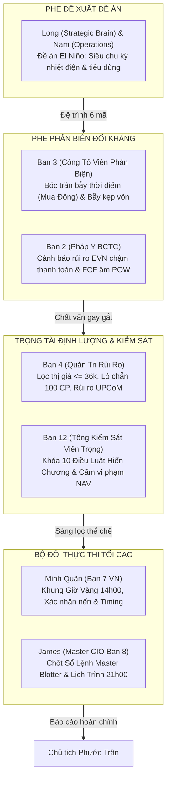

# BIÊN BẢN HỘI NGHỊ TRANH BIỆN ĐỐI KHÁNG TAM GIÁC ĐA PHÒNG BAN (APEX WAR ROOM)
## CHỦ ĐỀ: MỔ XẺ TOÀN DIỆN KỊCH BẢN SIÊU EL NIÑO 2026–2027 & ĐÁNH GIÁ TÍNH THỜI ĐIỂM — CƠ HỘI ĐẦU TƯ THỰC CHIẾN

**Kính trình**: **Chủ tịch Hội đồng Quản trị kiêm Tổng Tư lệnh Tối cao — Trần Quốc Thiên Phước**  
**Chủ trì điều phối**: **Master CIO James** (Ban 8 — Tổng Tư Lệnh Phân Bổ Vốn Thống Nhất Apex)  
**Thời gian tiến hành**: 19:55 – 20:30 Ngày 08/11/2026  
**Địa điểm**: Phòng Hội Chẩn Chiến Lược Trực Tuyến & Apex Executive War Room  
**Quy chế kiểm sát**: Tuân thủ nghiêm ngặt 10 Điều Luật Bất Biến trong **Hiến Chương Doanh Nghiệp Apex V1.0**; Tranh biện đối kháng 3 góc (Phe Đề Xuất vs Phe Phản Biện Đối Kháng vs Trọng Tài Định Lượng); Giám sát tối cao bởi Tổng Kiểm Sát Viên Trọng (Ban 12).

---

### THÀNH PHẦN THAM DỰ ĐẦY ĐỦ 100%
1. **Chủ tịch Phước Trần** (Chỉ đạo tối cao, người giữ Smart OTP và quyết định cuối cùng).
2. **James** (Master CIO Ban 8 — Chủ trì).
3. **Long** (Chief Strategic Brain) & **Nam** (Executive Daily Operations) — *Phe Đề Xuất Đề Án El Niño*.
4. **Ban 1 VN & Macro** (`vn-macro-monetary-agent`): Chuyên gia Vĩ mô & Chu kỳ Tiền tệ.
5. **Ban 2 VN** (`vn-equity-bctc-agent`): Chuyên gia Pháp y BCTC & Dòng tiền OCF/FCF.
6. **Ban 3 VN** (`vn-synthesis-hub-agent`): *Công tố viên Phản biện / Kẻ thù giả định (Devil's Advocate)*.
7. **Ban 4 VN** (`vn-investment-committee-agent`): Trọng tài Định lượng & Quản trị Rủi ro.
8. **Ban 7 VN — Minh Quân** (`vn-daily-specialist-agent`): Chuyên viên Đầu tư Trưởng Thực thi.
9. **Ban 9 — Victor** (`live-portfolio-sentinel-agent`): Trực chiến Giám sát Rủi ro Thời gian thực.
10. **Ban 10 — Hiền** (`hien-bctc-scout-agent`): Trinh sát Dữ liệu BCTC & Quan hệ Cổ đông (IR).
11. **Ban 12 — Trọng** (`trong-inspector-agent`): Tổng Kiểm Sát Viên Thể Chế, Kỷ Luật & Toàn Vẹn Hệ Thống.

---

---

## PHẦN I: XÁC NHẬN CHỈ THỊ THỂ CHẾ CỦA CHỦ TỊCH
1. **Dời lịch Hội nghị Điều hành EOD tối nay**:
   - Chính thức dời từ **20h00 sang 21h00 (9h tối nay, 08/11/2026)** theo đúng lệnh của Chủ tịch.
   - Master CIO James đã kích hoạt `scripts/telegram_dispatcher.py` gửi thông báo xác nhận thành công (Status: True) tới Topic `james_hq` (Topic 6) để toàn thể 12 phòng ban đồng bộ đồng hồ tác chiến.
2. **Nhiệm vụ trọng tâm trước 21h00**:
   - Triệu tập ngay War Room để trả lời rốt ráo 2 câu hỏi của Chủ tịch:
     - **Câu hỏi 1**: *Liệu chúng ta có nên để tâm tới vấn đề El Niño này bây giờ không?*
     - **Câu hỏi 2**: *Có nên đầu tư vào các mã cổ phiếu tiềm năng ở sự kiện này không nhỉ?*

---

## PHẦN II: BIÊN BẢN TRANH LUẬN ĐỐI KHÁNG ĐA PHÒNG BAN

### 1. Phe Đề Xuất (Long & Nam) — Trình bày Luận điểm Vĩ mô & Đề án 6 Mã
**Đồng chí Long (Chief Strategic Brain)**:
> *"Thưa Chủ tịch và các phòng ban, đề án El Niño 2026–2027 được chúng tôi nghiên cứu từ số liệu khí tượng WMO, NOAA và thực tế phụ tải điện Việt Nam. Khi El Niño xảy ra, hạn hán khiến toàn bộ hệ thống thủy điện (vốn chiếm 30-35% sản lượng điện quốc gia) tê liệt vì hồ chứa cạn kiệt. EVN bắt buộc phải huy động tối đa nhiệt điện than và khí trên thị trường điện cạnh tranh (CGM). Chúng tôi đề xuất danh mục 6 mã: QTP, HND, QNS, POW, BWE, MWG với kịch bản Barbell (40% cổ tức, 35% tăng trưởng, 25% tiền mặt)."*

**Đồng chí Nam (Executive Operations)**:
> *"Về dòng tiền, QTP và HND đã khấu hao gần hết, sạch nợ vay, chi trả cổ tức tiền mặt 10% - 14%/năm, P/E < 8.5x. QNS nắm giữ hơn 6.500 tỷ tiền mặt, cổ tức 8%, chuỗi giá trị đường - điện sinh khối tự chủ. Đây là cơ hội phòng thủ tuyệt vời cho danh mục."*

---

### 2. Phe Phản Biện Đối Kháng (Ban 3 & Ban 2) — "Dội Gáo Nước Lạnh" Chất Vấn Gay Gắt

**Trưởng Ban 3 VN (Công Tố Viên Phản Biện / Kẻ Thù Giả Định)**:
> *"Khoan đã anh Long và anh Nam! Báo cáo của hai anh rất đẹp trên giấy tờ, nhưng dưới lăng kính thị trường thực chiến, tôi xin vạch trần ngay **3 LỖ HỔNG CHẾT NGƯỜI VỀ TÍNH THỜI ĐIỂM (TIMING) VÀ BẪY KẸP VỐN**:
> 
> **Lỗ hổng 1 — Sai lệch tính Mùa Vụ (Seasonality) nghiêm trọng**:
> Bây giờ là **Tháng 11/2026 — miền Bắc đang bước vào MÙA ĐÔNG**. 
> - Nhu cầu điện miền Bắc vào mùa đông giảm cực mạnh do không ai bật điều hòa, phụ tải điện công nghiệp duy trì bình thường, không hề có tình trạng cắt điện luân phiên hay thiếu điện căng thẳng.
> - Cơn sốt thiếu điện và thiếu nước chỉ thực sự bùng nổ vào **Tháng 4 – Tháng 7 hàng năm (Đỉnh điểm mùa hè nắng nóng)**.
> - **Nếu chúng ta mua QTP, HND hay MWG ngay bây giờ, đồng vốn 20 triệu của Chủ tịch sẽ bị CHÔN CHẶT suốt 4 đến 5 tháng mùa đông không tạo ra lợi nhuận!** Trong khi đó, dòng tiền thị trường đang chảy mạnh vào các ngành khác. Đó là cái giá cơ hội (Opportunity Cost) cực lớn!
> 
> **Lỗ hổng 2 — Vi phạm Hiến Chương Doanh Nghiệp Apex đối với MWG**:
> - Anh Long đề xuất MWG với giá 74.500đ. Với tài khoản của Chủ tịch hiện có **20.199.425 ₫**, một lô chẵn 100 CP MWG có giá trị **7.450.000 ₫ (chiếm tới 36.88% NAV)**!
> - Điều này **VI PHẠM TRỰC TIẾP ĐIỀU LUẬT 6 VÀ ĐIỀU CẤM SỐ 2 TRONG HIẾN CHƯƠNG DOANH NGHIỆP**: *Cấm giải ngân vào bất kỳ cổ phiếu nào mà 1 lô chẵn 100 CP vượt quá 33% NAV*. Đề xuất này phải bị BÁC BỎ NGAY LẬP TỨC!
> 
> **Lỗ hổng 3 — Rủi ro thị trường chung VN-Index**:
> - Phiên Thứ Sáu vừa rồi, VN-Index đóng cửa 1.725,36 điểm, thủng MA20 và đang trên đà kiểm định lại vùng 1.700 – 1.710 điểm. Khối ngoại bán ròng 10 phiên liên tiếp. Việc vội vàng mua cổ phiếu phòng thủ lúc này chẳng khác nào 'bắt dao rơi' của đà điều chỉnh chung!"*

**Trưởng Ban 2 VN (Pháp Y BCTC & Kiểm Toán Dòng Tiền)**:
> *"Tôi bổ sung bằng chứng từ BCTC kiểm toán để mổ xẻ rủi ro của **POW** và **khoản phải thu EVN**:
> 1. **Đối với POW**: Dòng tiền tự do FCF của POW đang **ÂM NẶNG -6.040 TỶ ĐỒNG** do đang tập trung giải ngân vốn khổng lồ cho đại dự án Nhà máy điện Nhơn Trạch 3 & 4. Tổng nợ vay tài chính lên tới **37.525 tỷ đồng**. Biên lợi nhuận mảng điện khí cực kỳ nhạy cảm với giá dầu Brent và giá LNG nhập khẩu. POW không phải là cổ phiếu phòng thủ cổ tức, mà là một cỗ máy thâm dụng vốn đang chịu rủi ro chậm tiến độ!
> 2. **Rủi ro EVN chậm thanh toán tiền điện**: Cả QTP, HND và POW đều có khách hàng độc quyền duy nhất là Công ty Mua bán điện (EPTC) thuộc Tập đoàn Điện lực Việt Nam (EVN). Hiện nay EVN đang chịu áp lực tài chính lớn, dẫn đến việc chậm trễ thanh toán tiền điện trên thị trường CGM. Khoản phải thu khách hàng của các nhà máy điện than chiếm từ 20-30% tổng tài sản. Nếu EVN nghẽn dòng tiền, cổ tức của QTP và HND có thể bị trì hoãn chi trả!"*

---

### 3. Ý Kiến Trọng Tài Định Lượng & Kỷ Luật Thể Chế (Ban 4 & Ban 12)

**Trưởng Ban 4 VN (Hội Đồng Định Lượng & Quản Trị Rủi Ro)**:
> *"Dưới góc độ quản trị danh mục định lượng với quy mô vốn thực tế **20.199.425 ₫** tại TCBS:
> - **Sàng lọc thị giá ($\le 36.000$ ₫)**:
>   - **LOẠI BỎ MWG** (74.5k) — Vi phạm trần tỷ trọng $33\%$ NAV.
>   - **CẢNH BÁO QNS** (47.5k) — 1 lô 100 CP = 4,75 triệu (chiếm 23.5% NAV, hơi cao, chỉ được giải ngân tối đa 1 lô nếu có điểm mua hoàn hảo).
>   - **CÁC MÃ ĐẠT CHUẨN ĐỊNH CỠ**: **QTP** (14.8k $\rightarrow$ 1 lô = 1,48 triệu $\approx 7.3\%$ NAV), **HND** (13.5k $\rightarrow$ 1 lô = 1,35 triệu $\approx 6.7\%$ NAV), **POW** (11.8k $\rightarrow$ 1 lô = 1,18 triệu $\approx 5.8\%$ NAV).
> - **Rủi ro sàn UPCoM**: Cả QTP, HND, QNS đều giao dịch trên UPCoM với biên độ $\pm 15\%$, không có cơ chế khớp lệnh định kỳ ATO/ATC rõ ràng, thanh khoản thấp hơn HOSE. Nếu thị trường sập hoảng loạn, rủi ro trượt giá (Slippage) của cổ phiếu UPCoM rất lớn. Ngưỡng cắt lỗ Stop Loss bắt buộc phải khóa cứng ở mức $2\text{x}ATR \le 7.0\% - 7.5\%$."*

**Đồng chí Trọng (Tổng Kiểm Sát Viên Thể Chế — Ban 12)**:
> *"Tôi ghi nhận và biểu dương tinh thần tranh biện đối kháng thẳng thắn của Ban 3 và Ban 2. 
> Chiếu theo **Hiến Chương Doanh Nghiệp Apex V1.0**:
> 1. Nghiêm cấm mọi hành vi 'vẽ sóng bánh vẽ' để mua đuổi khi chưa đúng thời điểm.
> 2. Phủ quyết dứt khoát mã **MWG** khỏi danh mục thực thi vì vi phạm Điều Luật 6 (1 lô > 33% NAV).
> 3. Tuyệt đối tuân thủ trạng thái **100% TIỀN MẶT HIỆN TẠI** cho đến khi có tín hiệu kiểm định hỗ trợ VN-Index 1.700 điểm thành công."*

---

### 4. Kết Luận Thực Thi Từ Chuyên Viên Minh Quân (Ban 7 VN) & Master CIO James (Ban 8)

**Minh Quân (Chuyên Viên Đầu Tư Trưởng VN — Ban 7)**:
> *"Thưa Chủ tịch, tôi xin trả lời dứt khoát 2 câu hỏi của Chủ tịch từ góc độ tác chiến bảng điện thực tế:
> 
> **Câu hỏi 1: 'Liệu chúng ta có nên để tâm tới vấn đề El Niño này bây giờ không?'**
> $\rightarrow$ **CÓ ĐỂ TÂM, NHƯNG LÀ ĐỂ TÂM CHIẾN LƯỢC ĐƯA VÀO DANH MỤC THEO DÕI (WATCHLIST), CHỨ TUYỆT ĐỐI CHƯA MUA GOM TRONG TUẦN TỚI!**
> - *Lý do*: Thời điểm này là tháng 11, chu kỳ thời tiết miền Bắc đang lạnh dần. Sóng cổ phiếu nhiệt điện và tiêu dùng giải nhiệt chưa thể chạy ngay. Dòng tiền thông minh thường gom ngầm nhóm này vào giai đoạn **Cuối Quý 1 / Đầu Quý 2 (Tháng 2 – Tháng 4/2027)** khi thời tiết bắt đầu chuyển mùa và BCTC Quý 1 hé lộ số liệu thủy điện cạn nước.
> - Việc 'để tâm' từ bây giờ giúp chúng ta đi trước thị trường 1 bước về mặt dữ liệu, sẵn sàng đón lõng khi giá cổ phiếu bị đạp sâu về các vùng hỗ trợ dài hạn.
> 
> **Câu hỏi 2: 'Có nên đầu tư vào các mã cổ phiếu tiềm năng ở sự kiện này không nhỉ?'**
> $\rightarrow$ **CHỌN LỌC CỰC KỲ KHẮT KHE: CHỈ ĐẦU TƯ 2 TRÊN 6 MÃ KHI ĐẠT ĐIỀU KIỆN KỸ THUẬT, BÁC BỎ 4 MÃ CÒN LẠI!**
> 
> - **MÃ SỐ 1 ĐƯỢC CHẤP THUẬN (ƯU TIÊN HÀNG ĐẦU): QTP (Nhiệt điện Quảng Ninh)**:
>   - *Đánh giá*: Đây là cổ phiếu xứng đáng nhất trong toàn bộ kịch bản. Khấu hao đã hết, sạch nợ vay, tỷ suất cổ tức tiền mặt 11% – 13%/năm (cao gấp đôi lãi suất ngân hàng). Thị giá 14.8k cực kỳ phù hợp với quy mô NAV 20 triệu (1 lô 100 CP chỉ 1,48 triệu).
>   - *Hành động*: **Chưa mua ngay**. Kiên nhẫn chờ nhịp chỉnh của thị trường chung đưa QTP về vùng hỗ trợ cứng **13.800 – 14.200 đ/CP** kèm tín hiệu VSA cạn kiệt nguồn cung (No Supply) thì mới giải ngân thăm dò nhịp 1 (30%).
> 
> - **MÃ SỐ 2 ĐƯỢC ĐƯA VÀO DANH SÁCH THEO DÕI ĐẶC BIỆT: QNS (Đường Quảng Ngãi)**:
>   - *Đánh giá*: Doanh nghiệp xuất sắc, tiền mặt 6.500 tỷ, chuỗi giá trị tuần hoàn, hưởng lợi từ hạn hán mất mùa mía toàn cầu. Tuy nhiên thị giá 47.5k nên tỷ trọng phải khống chế chặt chẽ.
>   - *Hành động*: Chờ chiết khấu về vùng **44.000 – 45.500 đ/CP**, nếu có nến đảo chiều mới cân nhắc tối đa 1 lô 100 CP.
> 
> - **4 MÃ BỊ LOẠI TRỪ / PHỦ QUYẾT**:
>   1. **MWG (74.5k)**: **BÁC BỎ 100%** vì vi phạm Hiến Chương (1 lô = 37% NAV).
>   2. **POW (11.8k)**: **LOẠI BỎ** vì FCF âm nặng (-6.040 tỷ), nợ vay 37.500 tỷ, đồ thị kỹ thuật yếu dưới MA200.
>   3. **HND (13.5k)**: **TẠM DỪNG**, trùng lặp vị thế ngành với QTP; tập trung duy nhất 1 mã đầu ngành tốt nhất là QTP để tối ưu danh mục.
>   4. **BWE (42.9k)**: **LOẠI BỎ**, thanh khoản thấp, biên độ hẹp, không tối ưu cho tài khoản cá nhân."*

---

## PHẦN III: KẾT LUẬN CỦA MASTER CIO JAMES & NGHỊ TRÌNH HỘI NGHỊ 21H00

**James (Master CIO — Tổng Tư Lệnh Phân Bổ Vốn Thống Nhất Apex)**:
> *"Kính thưa Chủ tịch Phước Trần, sau phiên tranh biện đối kháng nảy lửa và đầy trách nhiệm của các phòng ban, tôi xin tổng kết và đúc kết thành **NGHỊ QUYẾT HÀNH ĐỘNG THỐNG NHẤT** như sau:
> 
> 1. **Về Chỉ thị Dời Lịch Họp**: Đã thực thi 100%. Toàn bộ hệ thống sẵn sàng bước vào Hội nghị Điều hành EOD lúc **21h00 tối nay** dưới sự chủ trì trực tiếp của Chủ tịch.
> 2. **Về Bản chất Sự kiện El Niño**: Đây là một đề án vĩ mô rất chất lượng của Nam và Long, mở ra tầm nhìn cho chu kỳ 2026–2027. Tuy nhiên, tính thời điểm (Timing) chưa chín muồi để giải ngân ngay trong tháng 11/2026 vì tính mùa đông miền Bắc và thị trường chung VN-Index đang điều chỉnh.
> 3. **Về Danh mục Đầu tư**:
>    - Khóa chặt và chấp thuận duy nhất **QTP** vào danh mục Watchlist chiến lược gom phòng thủ hưởng cổ tức 13% khi giá nhúng về vùng **13.800 – 14.200 đ**.
>    - Bác bỏ dứt khoát **MWG** (vi phạm quy mô NAV) và **POW** (FCF âm nặng).
>    - Giữ trọn vẹn kỷ luật **100% TIỀN MẶT (20.199.425 ₫)** trong phiên sáng Thứ Hai để bảo vệ đồng vốn an toàn tuyệt đối."*

---

*Biên bản đã được niêm phong lưu trữ tại hồ sơ Ban 8 — Sẵn sàng trình chiếu trực tiếp trong Hội nghị 21h00 tối nay cùng Chủ tịch!*
