```mermaid
gantt
    title NGHỊ TRÌNH ĐẠI HỘI NGHỊ THƯỢNG ĐỈNH 21H00 - 21H30 (30 PHÚT)
    dateFormat mm
    axisFormat %M
    section GIAI ĐOẠN 1 (20 Phút Đầu)
    Khai mạc & Điểm danh tài khoản        :a1, 00, 3m
    Báo cáo Vĩ mô & Kịch bản VN-Index     :a2, after a1, 5m
    Pháp y BCTC & Lọc 145 cổ phiếu       :a3, after a2, 5m
    Quản trị rủi ro & Định cỡ vị thế    :a4, after a3, 4m
    Chiến thuật Khung Giờ Vàng 14h00     :a5, after a4, 3m
    section GIAI ĐOẠN 2 (10 Phút Cuối)
    Tranh biện nảy lửa & Phản biện chéo  :b1, 20, 5m
    Biểu quyết Sổ Lệnh Vòng 2            :b2, after b1, 3m
    Kiểm toán kỷ luật & Niêm phong lệnh   :b3, after b2, 2m
```

# 🏛️ KẾ HOẠCH TRIỂN KHAI ĐẠI HỘI NGHỊ THƯỢNG ĐỈNH TOÀN DOANH NGHIỆP
## KHUNG GIỜ: 21H00 – 21H30 TỐI CHỦ NHẬT (08/11/2026) — THỜI LƯỢNG CHUẨN: 30 PHÚT

**Chủ tọa tối cao**: **Chủ tịch Hội đồng Quản trị — Trần Quốc Thiên Phước**  
**Tổng Tư lệnh Điều phối**: **Master CIO James** (Ban 8) & **Palmer** (Cố vấn Điều hành)  
**Đơn vị kiểm sát thể chế**: **Tổng Kiểm Sát Viên Trọng** (Ban 12)  
**Quy mô tham dự**: Đầy đủ 100% thành viên (12 Phòng Ban + Long + Nam + Trọng)  
**Trạng thái tài sản SSOT V2.0**: **20,167,119 ₫ (100% TIỀN MẶT — 0 CP kẹp hàng)**  

---

---

## 1. GIAI ĐOẠN 1 (20 PHÚT ĐẦU: 21H00 – 21H20) — NGHIÊN CỨU & BÁO CÁO CÔNG VIỆC CHUẨN BỊ

* **Phút 00 – 03 (Khai mạc & Điểm danh)**:
  * **James & Palmer**: Tuyên bố lý do, điểm danh sự có mặt đầy đủ của 12 Ban + Long + Nam + Trọng.
  * **Nam (Trợ lý Điều hành)**: Đối soát và xác nhận công khai số dư tài khoản thực tế: **20,167,119 ₫ (100% TIỀN MẶT — 0 CP kẹp hàng)**.

* **Phút 03 – 08 (Báo cáo Vĩ mô & Xu hướng tuần mới)**:
  * **Ban 1 (Vĩ mô) & Long (Strategic Brain)**: Báo cáo tác động của cú sập Phố Wall (-2.500 tỷ USD), áp lực tỷ giá USD/VND, chu kỳ tiền tệ SBV và kịch bản VN-Index kiểm định vùng **1.700 – 1.710 điểm**.

* **Phút 08 – 13 (Pháp y BCTC & Lọc 145 cổ phiếu)**:
  * **Ban 2 (Pháp Y BCTC) & Hiền (Ban 10 - IR)**: Trình chiếu số liệu kiểm toán Q3/2026, loại bỏ lợi nhuận giấy, xác nhận dòng tiền thật $OCF/LNST > 1.15x$ cho **Top 4: HDB (1.16x), MSH (1.42x), BAF (1.18x), IDC (1.48x)** và nhóm dự phòng PVT (3.659 tỷ OCF), TCB (CASA top 1).

* **Phút 13 – 17 (Quản trị rủi ro & Định cỡ vị thế)**:
  * **Ban 4 (Hội Đồng Định Lượng)**: Báo cáo công thức Position Sizing chuẩn hóa: Khóa cứng rủi ro $\le 1.5\%$ NAV/trade, thị giá $\le 36k$, 1 lô 100 CP chỉ chiếm $11\% - 17\%$ NAV, Stop Loss $2\text{x}ATR \le 6.8\%$.

* **Phút 17 – 20 (Chiến thuật thực thi rình mồi)**:
  * **Minh Quân (Ban 7 VN)**: Trình bày quy tắc Khung Giờ Vàng (**14h00 – 14h25**), cấm FOMO ATO sáng Thứ Hai, kỹ thuật đặt lệnh Limit LO đón lõng tại các vùng giá gom.

---

## 2. GIAI ĐOẠN 2 (10 PHÚT CUỐI: 21H20 – 21H30) — TRANH BIỆN ĐỐI KHÁNG, BIỂU QUYẾT & KẾT LUẬN

* **Phút 20 – 25 (Phiên Tranh Biện Nảy Lửa & Phản Biện Chéo)**:
  * **Ban 3 (Công Tố Viên Phản Biện / Kẻ Thù Giả Định) và Ban 12 (Trọng)** chất vấn gay gắt:
    1. *Chất vấn BAF*: Giá nguyên liệu thức ăn chăn nuôi nhập khẩu tăng có bào mòn biên lợi nhuận của BAF không?
    2. *Chất vấn MSH*: Tại sao ưu tiên MSH thay vì TNG?
    3. *Chất vấn đề án El Niño*: Tại sao không mua QTP/HND ngay mà phải đợi Quý 1/2027?
  * Minh Quân, Long, Nam, Ban 2 và James trực tiếp phản hồi, dùng số liệu kế toán và dữ liệu cung cầu VSA để bảo vệ luận điểm.

* **Phút 25 – 28 (Biểu Quyết Thể Chế Toàn Diện)**:
  * 12 Trưởng ban, 2 Trợ lý và Chủ tọa tiến hành biểu quyết từng mã cổ phiếu trong **Sổ Lệnh Bắn Tỉa Vòng 2**.

* **Phút 28 – 30 (Kết Luận Thể Chế & Niêm Phong Nghị Quyết)**:
  * **Tổng Kiểm Sát Viên Trọng (Ban 12)**: Đọc bản kiểm toán kỷ luật, xác nhận hội nghị đạt chuẩn 100% "Làm thật việc thật", không vi phạm bất kỳ điều cấm nào trong Hiến Chương.
  * **Master CIO James**: Tuyên bố bế mạc, phát hành văn bản Nghị quyết chính thức và kính trình Chủ tịch Phước Trần ký duyệt ban hành.

---

## 3. TRẠNG THÁI SẴN SÀNG HIỆN TẠI (20H15 – 21H00)
- Toàn bộ 12 phòng ban đã nạp sẵn số liệu và slide trình chiếu.
- Master CIO James và Palmer trực tiếp điều phối phòng họp.
- Đúng 21h00, phòng họp trực tuyến kích hoạt đón Chủ tịch vào chủ trì!
