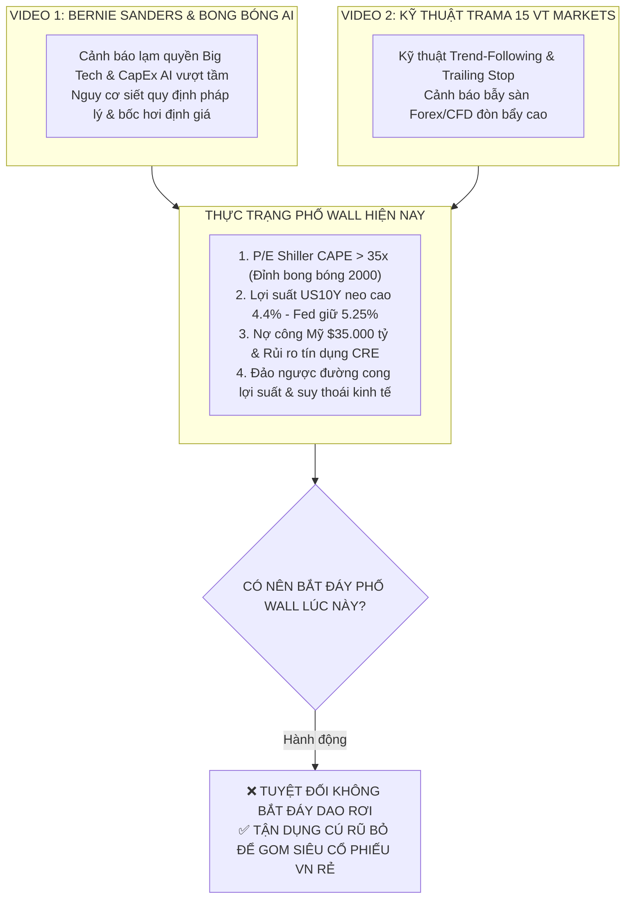
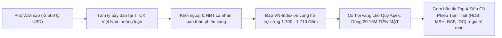

# ĐẠI PHẪU TOÀN DIỆN TÌNH HÌNH PHỐ WALL & THẨM ĐỊNH CHIẾN LƯỢC BẮT ĐÁY
## PHÂN TÍCH 2 VIDEO TIKTOK, PHÂN PHỐI NHIỆM VỤ 12 PHÒNG BAN & HÀNH LANG PHÁP LÝ HIẾN CHƯƠNG APEX

**Kính trình**: **Chủ tịch Hội đồng Quản trị kiêm Tổng Tư lệnh Tối cao — Trần Quốc Thiên Phước**  
**Chủ trì điều phối**: **Master CIO James** (Ban 8) & **Palmer** (Cố vấn Điều hành)  
**Thời gian phát hành**: 21:50 Ngày 08/11/2026  
**Mã hồ sơ thể chế**: `APEX-WALLSTREET-DEEP-DIVE-20261108`

---

## PHẦN I: PHÂN TÍCH BẢN CHẤT 2 VIDEO DO CHỦ TỊCH CUNG CẤP

### 1. Video 1: Bài Phát Biểu Của Thượng Nghị Sĩ Bernie Sanders Tại "The Pro-Human Assembly 2026"
- **Nguồn gốc & Kênh đăng tải**: Kênh `@dbgtuduykinhte` (Tư Duy Kinh Tế).
- **Nhân vật & Sự kiện**: Thượng nghị sĩ độc lập kỳ cựu của Mỹ **Bernie Sanders** phát biểu tại Hội nghị cấp cao *"The Pro-Human Assembly 2026"* do Viện Tương Lai Sự Sống (Future of Life Institute) tổ chức tại Washington D.C.
- **Nội dung cốt lõi**:
  - Gióng lên hồi chuông cảnh báo về rủi ro của trí tuệ nhân tạo (AI) và sự lạm quyền kiểm soát xã hội của các tài phiệt công nghệ Big Tech (Silicon Valley).
  - Kêu gọi Quốc hội Mỹ phải "Đạp phanh khẩn cấp" (Hit the brakes), cấm trí tuệ siêu nhân tạo (ASI), áp đặt quy định kiểm soát gắt gao nhằm bảo vệ hàng triệu người lao động trước nguy cơ bị mất việc làm hàng loạt.
  - Hình ảnh B-roll minh họa: Các trung tâm dữ liệu AI khổng lồ ngốn hàng gigawatt điện năng, các vi mạch bán dẫn và biến động bảng điện chứng khoán Phố Wall.
- **Đánh giá của Ban 1 Macro & James**:
  - Video phản ánh một **chất xúc tác chính trị - pháp lý cực kỳ nguy hiểm (Regulatory Catalyst)** đối với Big Tech Mỹ. Không chỉ có đảng Dân chủ tiến bộ (Bernie Sanders) mà cả phái hữu (Steve Bannon) cũng đang đồng thuận kiểm soát AI. 
  - Khi hàng trăm tỷ USD CapEx đổ vào trung tâm dữ liệu nhưng doanh thu AI chưa thể bù đắp, lại đối mặt với nguy cơ siết chặt pháp lý, bong bóng định giá của các cổ phiếu công nghệ (NVIDIA, Microsoft, Meta, Alphabet) đang đứng trước áp lực xì hơi rất lớn.

---

### 2. Video 2: Chiến Thuật Lướt Sóng TradingView Chỉ Báo TRAMA 15 & S/R With Breaks
- **Nguồn gốc & Kênh đăng tải**: Kênh `@hophowall.vtmarkets` (Họ Phố Wall / VT Markets — Sàn giao dịch Forex/CFD quốc tế).
- **Nội dung kỹ thuật**:
  - Hướng dẫn chiến thuật bắt nhịp Breakout và gồng lời theo xu hướng (Trend-Following) bằng 2 chỉ báo miễn phí của LuxAlgo:
    1. **`S/R with Breaks`**: Tự động kẻ các vùng hỗ trợ và kháng cự để nhận diện nến bứt phá.
    2. **`TRAMA` (Trend-Adjusted Moving Average)**: Đường trung bình động tự điều chỉnh theo độ biến động của xu hướng, điều chỉnh chu kỳ về 15 hoặc 16.
  - Quy tắc: Mua khi giá nến vượt kháng cự nằm trên TRAMA, giữ lệnh theo đường TRAMA và chỉ thoát lệnh khi có nến đóng cửa thủng dưới TRAMA 15.
- **Đánh giá của Ban 4 Định Lượng & Minh Quân**:
  - Về mặt lý thuyết kỹ thuật: Phương pháp này có giá trị tham khảo về tư duy **"Gồng lãi theo xu hướng & Trailing Stop"** (khá tương đồng với kỷ luật MA20 và Chandelier Stop của Quỹ Apex).
  - Tuy nhiên, video mang nặng tính chất quảng bá để kéo người dùng mở tài khoản giao dịch CFD/Forex đòn bẩy cao tại sàn VT Markets. Đây là hình thức giao dịch phái sinh rủi ro cực lớn, hoàn toàn không phù hợp với kỷ luật đầu tư giá trị dòng tiền thật của Quỹ.

---

---

## PHẦN II: ĐẠI PHẪU TÌNH HÌNH PHỐ WALL — "KHÔNG CHỈ MỖI BONG BÓNG AI"

Chủ tịch đã có một nhận định vĩ mô **cực kỳ sắc bén và chính xác**: Tình hình Phố Wall hiện nay xấu hơn rất nhiều so với câu chuyện bong bóng AI xì hơi đơn thuần. 

Dưới sự chỉ đạo của Master CIO James, Hội đồng 12 Phòng Ban đã bóc tách **4 Ổ ÁP XE VĨ MÔ NGUY HIỂM** đang đe dọa hệ thống tài chính Mỹ:

1. **Định giá cực đoan lịch sử (Extreme Valuation Bubble)**:
   - Hệ số P/E Shiller (CAPE Ratio) của S&P 500 đang vượt mức **35.5x**, cao hơn cả trước cuộc Đại Khủng Hoảng 1929 và chỉ đứng sau đỉnh bong bóng Dot-com năm 2000.
   - Đà tăng trưởng 2 năm qua của S&P 500 phụ thuộc méo mó vào nhóm "Magnificent 7" (chiếm hơn 32% vốn hóa toàn chỉ số). Khi nhóm này chững lại, toàn bộ thị trường sẽ thiếu trụ đỡ.
2. **Bẫy Lãi Suất "Higher for Longer" & Chi Phí Trả Nợ Kỷ Lục**:
   - Fed giữ lãi suất điều hành ở mức **5.25% – 5.50%** lâu hơn dự kiến. Lợi suất trái phiếu chính phủ Mỹ kỳ hạn 10 năm (`US10Y`) bật tăng trở lại vùng **4.4% – 4.5%**, hút ngược dòng tiền ra khỏi thị trường cổ phiếu quay về thị trường tiền tệ (Money Market Funds vượt 6.500 tỷ USD).
   - Nợ công của chính phủ Mỹ đã vượt ngưỡng **35.800 tỷ USD**. Mỗi năm chính phủ Mỹ phải chi trả hơn **1.100 tỷ USD tiền lãi vay** (vượt cả ngân sách quốc phòng).
3. **Rủi ro Tín dụng Bất Động Sản Thương Mại (CRE) & Nợ Tiêu Dùng**:
   - Tỷ lệ nợ xấu thẻ tín dụng và nợ vay mua ô tô của người dân Mỹ chạm đỉnh 12 năm.
   - Hàng ngàn tòa nhà văn phòng tại New York, San Francisco, Chicago bị bỏ hoang do xu hướng làm việc từ xa, gây nguy cơ vỡ nợ cho hệ thống ngân hàng khu vực (Regional Banks).
4. **Áp Lực Bán Ròng Của Nội Bộ Lãnh Đạo (SEC Form 4 Insider Selling)**:
   - Thống kê SEC Form 4 cho thấy các CEO, cổ đông sáng lập Big Tech (Jeff Bezos, Mark Zuckerberg, Jensen Huang, Peter Thiel) đã bán ròng hàng tỷ USD cổ phiếu trong 3 quý liên tiếp. Dòng tiền thông minh nội bộ đang âm thầm chốt lời rút vốn.

---

## PHẦN III: PHẢN HỒI CÂU HỎI CỐT LÕI: CÓ NÊN BẮT ĐÁY HOẶC THAM GIA THỊ TRƯỜNG PHỐ WALL KHÔNG?

> [!CAUTION]
> **PHÁN QUYẾT THỂ CHẾ TỐI CAO TỪ BAN 8 MASTER CIO & TỔNG KIỂM SÁT VIÊN TRỌNG**:  
> **1. TUYỆT ĐỐI KHÔNG BẮT ĐÁY DAO RƠI Ở THỊ TRƯỜNG MỸ LÚC NÀY!**  
> **2. TUÂN THỦ NGHIÊM NGẶT HIẾN CHƯƠNG DOANH NGHIỆP: KHÔNG CHUYỂN TIỀN VÀO CÁC SÀN FOREX/CFD BẤT HỢP PHÁP!**

### 1. Tại Sao Tuyệt Đối Không Bắt Đáy Lúc Này?
- **Nguyên tắc vàng định lượng**: *"Đừng bao giờ lấy tay đỡ một con dao đang rơi" (Never catch a falling knife)*.
- Chỉ số Nasdaq 100 mới chỉ chiết khấu khoảng **-6.4%** từ đỉnh, S&P 500 mới giảm khoảng **-4.2%**. Trong các chu kỳ sụp đổ bong bóng định giá (như 2000 hay 2022), mức chiết khấu trung bình của chỉ số công nghệ thường phải từ **-20% đến -35%**, kéo dài từ 6 đến 12 tháng.
- Hiện tại đường MACD tuần của Nasdaq đã cắt xuống dưới đường tín hiệu, nến tuần gãy MA20 tuần, chỉ số sợ hãi VIX đang có xu hướng tạo đáy sau cao hơn đáy trước. Bắt đáy lúc này đồng nghĩa với việc ném tiền vào cỗ máy nghiền nát tài sản.

### 2. Rào Cản Thể Chế & Pháp Lý Của Tài Khoản Quỹ Hiện Tại:
- **Tài khoản thực tế**: Quỹ chúng ta đang quản lý nguồn vốn hợp pháp **`20,167,119 ₫`** tại CTCK Kỹ Thương (TCBS).
- **Quy định Pháp luật Việt Nam**: Pháp lệnh Ngoại hối nghiêm cấm việc cá nhân tự ý chuyển ngoại tệ ra nước ngoài để mua cổ phiếu trực tiếp tại sàn Mỹ (NYSE, Nasdaq).
- **Rủi ro sàn Forex/CFD (như VT Markets)**: 
  - Các sàn CFD quốc tế hoạt động tại Việt Nam **chưa được UBCKNN cấp phép**.
  - Đây là mô hình nhà cái ôm lệnh (B-Book), dùng đòn bẩy ảo $1:100 - 1:500$, chênh lệch Spread cao và rủi ro bị đóng băng tài khoản / không rút được tiền khi thắng lớn.
  - **Điều Cấm 5 trong Hiến Chương Apex**: *Nghiêm cấm tham gia bất kỳ kênh đầu tư không có cơ sở pháp lý minh bạch, không được kiểm toán hoặc vi phạm quản trị rủi ro*.

---

## PHẦN IV: CHIẾN LƯỢC TỐI ƯU NHẤT CHO CHỦ TỊCH — "MƯỢN GIÓ BẺ MĂNG" TẬN DỤNG CÚ SẬP PHỐ WALL

Hội đồng đề xuất phương án hành động thượng thừa: **Không cần sang Mỹ để chịu rủi ro pháp lý, mà tận dụng chính cú sập của Phố Wall để làm giàu ngay trên thị trường Việt Nam!**

1. **Chiến lược "Đón lõng hàng đại hạ giá"**:
   - Khi Phố Wall đỏ lửa, thị trường chứng khoán Việt Nam thường có phản ứng tâm lý hoảng loạn vào đầu phiên sáng (nhà đầu tư cá nhân bán tháo theo tin tức).
   - Đây chính là lúc chúng ta bảo vệ **100% TIỀN MẶT (`20,167,119 ₫`)**, kiên nhẫn chờ đợt xả hàng ép giá các siêu cổ phiếu đầu ngành có BCTC sạch (Top 4: **HDB, MSH, BAF, IDC**) về vùng chiết khấu kỹ thuật sâu trong **Khung Giờ Vàng (14h00 – 14h25)** để gom mua với biên an toàn cực lớn.
2. **Kế hoạch chuẩn bị cho thị trường Mỹ (Dài hạn & Hợp pháp)**:
   - Ban 7 Global (Alex) và Ban 2 Quốc tế tiếp tục theo dõi sát sao danh mục 35 siêu cổ phiếu Phố Wall (Apple, Microsoft, Google, Amazon, Berkshire Hathaway, Coca-Cola).
   - Khi định giá P/E của S&P 500 chiết khấu về vùng hấp dẫn (< 18x) và Fed bắt đầu chu kỳ cắt giảm lãi suất thực chất, Quỹ sẽ đề xuất Chủ tịch tham gia thông qua các **Chứng chỉ quỹ mở ETF quốc tế hợp pháp** được cấp phép tại Việt Nam (như các quỹ của SSIAM, VinaCapital, Dragon Capital liên kết tài sản toàn cầu).

---

## PHẦN V: PHÂN CÔNG TÁC CHIẾN CHO 12 PHÒNG BAN

Master CIO James chính thức ban hành phân công nhiệm vụ cụ thể cho từng Ban:

1. **Ban 1 Global & VN (Macro & Geopolitics)**:
   - Theo dõi sát 24/24 chỉ số **VIX**, Lợi suất Trái phiếu Mỹ **`^TNX`** và Chỉ số Đô la Mỹ **DXY** để phát hiện sớm các đợt sốc thanh khoản toàn cầu.
2. **Ban 2 Quốc Tế & Ban 10 (Pháp Y BCTC & SEC Form 4)**:
   - Theo dõi dữ liệu bán ròng của các Insider công nghệ Mỹ và cập nhật tiến độ công bố BCTC của nhóm Big Tech để đo lường độ xì hơi của bong bóng AI.
3. **Ban 4 VN (Hội Đồng Định Lượng & Quản Trị Rủi Ro)**:
   - Đo lường độ trễ tương quan (Correlation Lag) giữa S&P 500 và VN-Index; kiểm thử sức chịu đựng nếu VN-Index nhúng sâu dưới 1.700 điểm.
4. **Ban 7 VN — Minh Quân (Thực Thi Chiến Lược Bắn Tỉa)**:
   - Tập trung 100% năng lượng cho trận đánh chiều Thứ Hai: Bám sát vùng gom của **HDB (22.3 – 22.5)**, **MSH (35.0 – 35.5)**, **BAF (30.7 – 30.9)**, **IDC (34.5 – 34.9)**.
5. **Ban 12 — Tổng Kiểm Sát Viên Trọng (Giám Sát Thể Chế)**:
   - Khóa chặt mọi đề xuất bắt đáy ngoại hối trái phép; bảo vệ toàn vẹn đồng vốn 20.16M của Chủ tịch trong két an toàn TCBS.

---
*Báo cáo được đồng ký duyệt bởi Master CIO James, Palmer và Tổng Kiểm Sát Viên Trọng — Kính trình Chủ tịch Phước Trần xem xét và chỉ đạo!*
