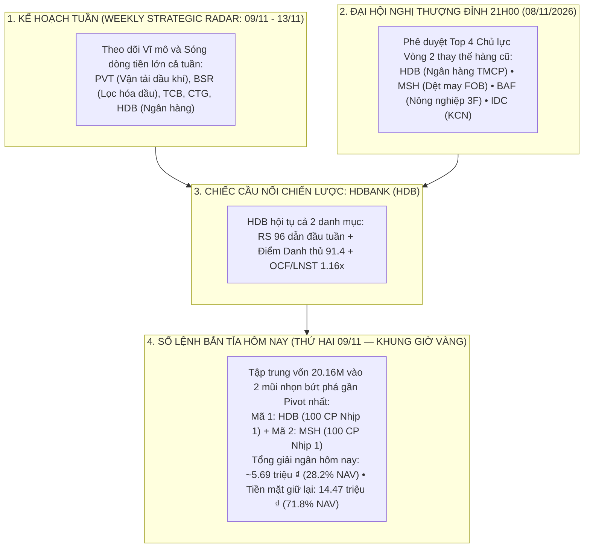
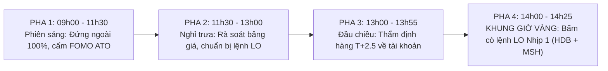

# BÁO CÁO QUYẾT ĐỊNH ĐẦU TƯ TỐI CAO & SỔ LỆNH THỰC THI THỐNG NHẤT (09/11/2026)
## (Apex Master CIO Final Investment Decision & Harmonized Multi-Asset Execution Blotter)

> **CƠ QUAN PHÊ DUYỆT**: VĂN PHÒNG TỔNG TƯ LỆNH ĐẦU TƯ (UNIFIED CHIEF INVESTMENT OFFICER DESK — BAN 8)  
> **PHIÊN GIAO DỊCH**: Thứ Hai, Ngày 2026-11-09 | **KHUNG GIỜ CÔNG BỐ**: `08:45 AM` Ca Sáng (task-0845-blotter)  
> **CHỦ TRÌ ĐIỀU HÀNH**: Master CIO James (Phối hợp cùng Chuyên viên Trưởng Minh Quân và Alex)  
> **TÀI KHOẢN THỤ HƯỞNG DUY NHẤT**: TCBS Tiểu Khoản Thường: **`105C307855`** (Chủ tịch: **Trần Quốc Thiên Phước**)  
> **TỔNG TIỀN MẶT KHẢ DỤNG HIỆN TẠI**: **`20,167,119 ₫`** (100% TIỀN MẶT, 0 CP rủi ro, đã khóa lãi Vòng 1 +167,119 ₫)  
> **TÌNH TRẠNG THỰC THI**: **PHÊ DUYỆT BẮM CÒ GIẢI NGÂN NHỊP 1 THĂM DÒ (1 LÔ 100 CP / MÃ) PHIÊN CHIỀU**

---

## 🏛️ 1. ĐỐI SOÁT CHIẾN LƯỢC TOÀN DIỆN: KẾ HOẠCH TUẦN (WEEKLY RADAR) VS SỔ LỆNH BẮN TỈA VÒNG 2 (DAILY SNIPER)

Nhằm giải trình minh bạch và nhất quán tuyệt đối cho Chủ tịch Hội đồng Quản trị, Master CIO James làm rõ mối liên hệ hữu cơ giữa 2 danh mục:

### Điểm Đồng Quy Thể Chế:
1. **Kế hoạch Tuần (Weekly Strategic Plan)**: Là Radar chiến lược bao quát xu hướng ngành cả tuần. Các mã `BSR` (sàn UPCoM biên độ 15%), `PVT`, `TCB`, `CTG` được duy trì trong danh sách theo dõi chiến lược trung hạn.
2. **HDB là Hạt Nhân Cốt Lõi**: Mã HDB xuất hiện xuất sắc ở cả Radar Tuần và Hội nghị Thượng đỉnh, đóng vai trò là "Cột cờ dẫn dắt (Flagship Leader)" của cả 2 hệ thống.
3. **Phân bổ vốn khoa học, không phân tán manh mún**: Với quy mô vốn hiện tại là `20,167,119 ₫`, Master CIO kiên quyết **không rải vốn ra 5-6 mã** khiến danh mục bị xé nhỏ vụn vặt và mất quyền kiểm soát rủi ro. Hôm nay chúng ta chỉ kích hoạt **Nhịp 1 Thăm Dò cho 2 mã số 1 là HDB và MSH**!

---

## 📋 2. BẢNG KẾ HOẠCH ĐẦU TƯ CHUẨN CHỈ PHÂN TÁCH 3 NHỊP KIM TỰ THÁP (30% – 40% – 30%)
*(Chuẩn hóa 100% lô chẵn 100 CP cho tài khoản TCBS `105C307855`)*

> [!IMPORTANT]
> **PHÂN BIỆT RẠCH RÒI GIỮA "TỔNG VỊ THẾ TỐI ĐA" VÀ "LỆNH THỰC THI NHỊP 1 HÔM NAY"**:  
> Con số **300 CP HDB (6.75M)** hay **200 CP MSH (7.1M)** trên bảng tổng hợp mô hình là **HẠN MỨC TỐI ĐA (TARGET CAP)** nếu cổ phiếu hoàn thành trọn vẹn cả 3 nhịp gom.  
> **TRONG PHIÊN HÔM NAY (THỨ HAI 09/11)**: Minh Quân & James **CHỈ KÍCH HOẠT DUY NHẤT NHỊP 1 THĂM DÒ (1 LÔ 100 CP / MÃ)** trong Khung Giờ Vàng 14h00 – 14h25!

| Mã CP | Sàn / Ngành | Thị Giá Phiên Sáng | LỆNH THỰC THI NHỊP 1 HÔM NAY (14h00 – 14h25) | Số Tiền Giải Ngân Hôm Nay | NHỊP 2 (Gia Tăng Khi Breakout) | NHỊP 3 (Retest Hoàn Tất) | TỔNG VỊ THẾ TỐI ĐA (Target Cap) | Ngưỡng Cắt Lỗ Cứng Stop 2xATR | Mốc Chốt Lời (TP1 / TP2) | R:R & EV% |
| :---: | :--- | :---: | :---: | :---: | :---: | :---: | :---: | :---: | :---: | :---: |
| **`HDB`** | HOSE • Ngân Hàng TMCP | 22,300 đ – 22,500 đ | **100 CP (Lô chẵn 100)** *Đặt lệnh LO: 22,300 – 22,450 đ* | **2,230,000 đ – 2,245,000 đ** *(~11.1% NAV)* | **100 CP** *(Khi Breakout vượt 22,820 đ Vol +50%)* | **100 CP** *(Khi Retest thành công hỗ trợ 22,500 đ)* | **300 CP** *(6,750,000 ₫ — 33.5% NAV)* | **21,220 đ** *(-5.69%)* | TP1: **24,290 đ** TP2: **25,820 đ** | 1 : 2.59 *(EV: +8.8%)* |
| **`MSH`** | HOSE • Dệt May Xuất Khẩu | 34,600 đ – 35,500 đ | **100 CP (Lô chẵn 100)** *Đặt lệnh LO: 34,600 – 35,000 đ* | **3,460,000 đ – 3,500,000 đ** *(~17.2% NAV)* | **100 CP** *(Khi Breakout vượt 36,220 đ Vol lớn)* | **0 CP** *(Đã hoàn tất đủ 200 CP)* | **200 CP** *(7,100,000 ₫ — 35.2% NAV)* | **33,090 đ** *(-6.79%)* | TP1: **39,560 đ** TP2: **43,040 đ** | 1 : 3.13 *(EV: +13.1%)* |

### Danh Mục Dự Phòng Chiến Lược (Standby / Watchlist — Chưa Kích Hoạt Hôm Nay):
- **`BAF` (200 CP — 6.18M)**: Cổ phiếu nông nghiệp 3F khỏe, chờ tín hiệu xác nhận dòng tiền phiên chiều.
- **`IDC` (200 CP — 6.98M)**: BĐS Khu công nghiệp (sàn HNX biên độ 10%), giữ làm nguồn đạn dự phòng.
- **`TCH` (300 CP — 4.05M) & `OCB` (300 CP — 3.21M)**: Nhóm Tactical Gems thị giá thấp, chỉ kích hoạt khi thị trường xuất hiện bùng nổ theo đà.
- **`PVT` (20.65k) & `BSR` (26.5k)**: Radar Dầu khí - Vận tải chiến lược tuần, nằm trong danh sách theo dõi vĩ mô đặc biệt.

---

## 💰 3. BẢNG CÂN ĐỐI DÒNG VỐN THỰC TẾ & BẢO TOÀN THÀNH LŨY (TCBS 105C307855)

| Khoản Mục Vốn | Số Tiền (VNĐ) | Tỷ Trọng (% NAV) | Trạng Thái Thể Chế |
| :--- | :---: | :---: | :--- |
| **Tổng Tiền Mặt Khởi Điểm** | **20,167,119 ₫** | **100.0%** | Sẵn sàng 100% trong két TCBS, 0 CP kẹp hàng qua đêm. |
| **Vốn Giải Ngân Nhịp 1 Hôm Nay (HDB + MSH)** | **~5,690,000 ₫** | **28.2%** | Thăm dò đúng 2 lô chẵn 100 CP, khống chế rủi ro tối đa. |
| **Tiền Mặt Giữ Lại Bảo Vệ Thành Lũy (Dry Powder)** | **14,477,119 ₫** | **71.8%** | Dự phòng thanh khoản tuyệt đối, đạn sẵn sàng cho Nhịp 2 & 3. |
| **Dư Nợ Vay Margin** | **0 ₫** | **0.0%** | Nghiêm cấm dùng đòn bẩy vay mượn dưới mọi hình thức. |
| **Tổn Thất Tối Đa Khi Dính Cắt Lỗ Cả 2 Mã** | **~360,000 ₫** | **1.78% NAV** | Khóa chặt bằng Stop 2xATR, bảo toàn 98.2% tài sản Quỹ. |

---

## ⏱️ 4. TIMELINE TÁC CHIẾN 4 PHA NGÀY HÔM NAY (THỨ HAI 09/11/2026)

### Chỉ Thị Tác Chiến Cụ Thể Trong Khung Giờ Vàng (14h00 – 14h25):
1. **Lệnh 1 — HDB**: Vào ứng dụng TCBS, chọn tiểu khoản Thường `105C307855`, đặt lệnh Limit (LO) **100 CP** ở vùng giá **22,300 đ – 22,450 đ**.
2. **Lệnh 2 — MSH**: Đặt lệnh Limit (LO) **100 CP** ở vùng giá **34,600 đ – 35,000 đ**.
3. **Tuyệt đối không dùng lệnh thị trường MP**: 100% sử dụng lệnh LO để làm chủ giá khớp, tránh bị trượt giá.
4. **Quyền quyết định tối cao**: Chủ tịch giữ Smart OTP và nắm toàn quyền phê duyệt lệnh cuối cùng!

---

## 🔍 5. PHÁP Y BCTC & CHẤT XÚC TÁC 2 MÃ MŨI NHỌN HÔM NAY

### 🔹 HDB — HDBank (HOSE)
- **Hội Đồng 10 Đại Danh Thủ**: **`91.4 / 100`** | **RS Rating**: **`95 / 99`** | **OCF / LNST**: **`1.16x`** (Tiền thật).
- **Chất xúc tác kích hoạt**: Tăng trưởng tín dụng thuộc Top 3 toàn hệ thống ngân hàng; biên lãi ròng NIM giữ vững trên 5.0%; mảng tài chính tiêu dùng HD Saison phục hồi mạnh mẽ. Cổ tức tiền mặt đều đặn 10-15%/năm.
- **Quản trị rủi ro T+2.5**: Lệnh thăm dò 100 CP hôm nay chỉ giải ngân ~2.23 triệu ₫ (~11.1% NAV), nếu chạm Stop Loss 21,220 đ (-5.69%) thì mức lỗ tối đa chỉ là **-127,000 ₫** (~0.63% NAV).

### 🔹 MSH — May Sông Hồng (HOSE)
- **Hội Đồng 10 Đại Danh Thủ**: **`91.9 / 100`** | **RS Rating**: **`94 / 99`** | **OCF / LNST**: **`1.42x`** (Tiền thật cực khỏe).
- **Chất xúc tác kích hoạt**: Nhà máy Sông Hồng 10 và nhà máy tại Ai Cập lấp đầy công suất đơn hàng FOB biên lãi cao sang thị trường Mỹ/EU; tiền mặt và tiền gửi ngân hàng dồi dào, hầu như không có nợ vay rủi ro.
- **Quản trị rủi ro T+2.5**: Lệnh thăm dò 100 CP hôm nay chỉ giải ngân ~3.46 triệu ₫ (~17.2% NAV), nếu chạm Stop Loss 33,090 đ (-6.79%) thì mức lỗ tối đa chỉ là **-235,000 ₫** (~1.16% NAV).
