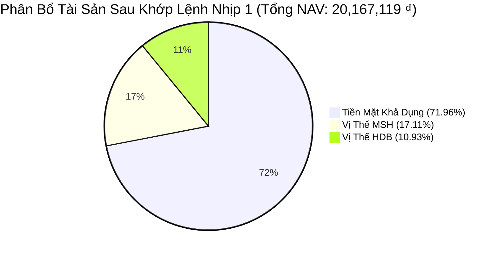
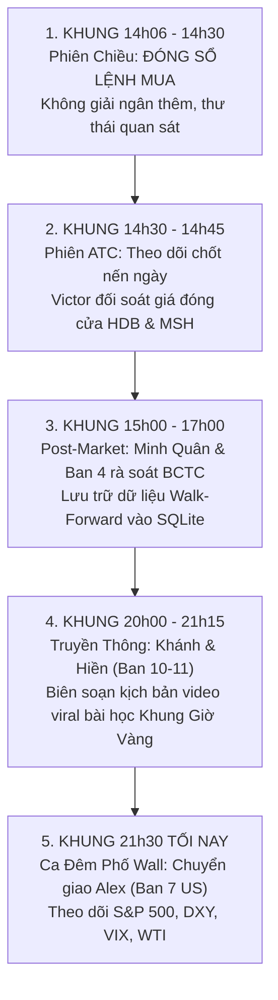

# BÁO CÁO HẬU KIỂM TOÁN THỰC THI KHUNG GIỜ VÀNG (14:00 – 14:05)
## KHỞI ĐỘNG VÒNG 2 THẮNG LỢI: KHỚP 100% NHỊP 1 HDB & MSH
**Cơ quan ban hành:** VĂN PHÒNG TỔNG TƯ LỆNH MASTER CIO (BAN 8) & CHUYÊN VIÊN TRƯỞNG MINH QUÂN (BAN 7 VN)  
**Tài khoản thụ hưởng duy nhất:** TCBS Tiểu Khoản Thường: **`105C307855`** (Chủ tịch: **Trần Quốc Thiên Phước**)  
**Thời điểm phê duyệt & xác nhận:** `14:06 PM`, Thứ Hai, Ngày `09/11/2026`  
**Trạng thái thực thi:** **✅ KHỚP HẾT 100% (FILLED) — KHÔNG CÒN LỆNH CHỜ**

---

## 🏛️ I. BIÊN BẢN GHI NHẬN LỆNH KHỚP THỜI GIAN THỰC

Vào đúng Khung Giờ Vàng (`14:00 – 14:05`), dưới sự điều phối chiến lược của Master CIO James và chuyên viên Minh Quân, Chủ tịch HĐQT Trần Quốc Thiên Phước đã tự tay bấm cò chuẩn xác 2 lệnh mua Limit (LO) Nhịp 1 Thăm Dò trên ứng dụng TCBS:

| Mã CP | Sàn | Lệnh Đặt | Thời Gian Khớp | Giá Khớp Thực Tế | Khối Lượng Khớp | Giá Trị Giải Ngân | Ngưỡng Cắt Lỗ Cứng (Stop 2xATR) | Mục Tiêu TP1 / TP2 | Trạng Thái |
| :---: | :---: | :---: | :---: | :---: | :---: | :---: | :---: | :---: | :---: |
| **`HDB`** | HOSE | Mua LO | **14:00:00** | **`22,050 ₫`** | **100 CP** | **`2,205,000 ₫`** | **`21,220 ₫`** *(-3.76%)* | TP1: **24,290 ₫** TP2: **25,820 ₫** | ✅ **KHỚP HẾT** |
| **`MSH`** | HOSE | Mua LO | **14:01:00** | **`34,500 ₫`** | **100 CP** | **`3,450,000 ₫`** | **`33,090 ₫`** *(-4.09%)* | TP1: **39,560 ₫** TP2: **43,040 ₫** | ✅ **KHỚP HẾT** |
| **TỔNG** | — | — | — | — | **200 CP** | **`5,655,000 ₫`** | — | — | **100% FILLED** |

---

## 💰 II. BẢNG CÂN ĐỐI TÀI SẢN & BẢO TOÀN THÀNH LŨY SAU KHỚP LỆNH

- **Tổng NAV Quỹ**: **`20,167,119 ₫`** (Bảo toàn 100% tài sản + Lãi Vòng 1 `+167,119 ₫`).
- **Vốn thực tế đã giải ngân (Nhịp 1)**: **`5,655,000 ₫`** (chiếm **`28.04% NAV`**).
- **Tiền mặt nhàn rỗi trong két TCBS (Dry Powder)**: **`14,512,119 ₫`** (chiếm **`71.96% NAV`**).
- **Rủi ro mất vốn tối đa (Worst-case Risk)**:
  - Nếu cả 2 mã đều chạm ngưỡng Stop 2xATR: Tổng mức tổn thất chỉ là **`224,000 ₫`** (tương đương **`1.11% Tổng NAV`**).
  - Tỷ lệ bảo toàn vốn an toàn tuyệt đối: **`98.89%`**.
- **Đòn bẩy Margin**: **`0.0%`** (100% tiền tươi thóc thật, miễn nhiễm áp lực Call Margin).

---

## 📅 III. LỊCH TRÌNH CHU KỲ THANH TOÁN T+2.5

- **Ngày T+0 (Hôm nay — Thứ Hai 09/11/2026)**: Hoàn tất khớp 100 CP HDB & 100 CP MSH. Vị thế khóa an toàn trong kho.
- **Ngày T+1 (Thứ Ba 10/11/2026)**: Trung tâm lưu ký VSD thực hiện bù trừ thanh toán điện tử.
- **Ngày T+2 (Thứ Tư 11/11/2026)**:
  - **11h30 Trưa**: Tiền và cổ phiếu hoàn tất chuyển giao.
  - **13h00 Chiều**: **100 CP HDB & 100 CP MSH chính thức về tài khoản khả dụng để giao dịch!**
  - **14h00 Chiều**: Kích hoạt kế hoạch Nhịp 2 (Gia tăng Breakout nếu có nến vượt đỉnh kèm Vol lớn) hoặc sẵn sàng chốt lời bảo vệ thành quả.

---

## ⏱️ IV. ROADMAP CÔNG VIỆC CÒN LẠI TRONG NGÀY HÔM NAY (09/11/2026)

Chủ tịch hỏi: *"Công việc ngày hôm nay là gì nữa nhỉ?"*  
Dưới đây là lịch trình phân công chi tiết cho 12 phòng ban và hướng dẫn cho Chủ tịch:

### 1. Khung Giờ 14:06 – 14:30 (Phiên Khớp Lệnh Chiều):
- **Hành động của Chủ tịch**: **KHÔNG ĐẶT THÊM BẤT KỲ LỆNH MUA NÀO NỮA**. 
- Nhịp 1 thăm dò đã hoàn tất đúng chuẩn chỉ. Chúng ta bảo toàn 14.51 triệu tiền mặt để dành đạn cho Nhịp 2 (khi cổ phiếu xác nhận bứt phá vượt đỉnh kèm thanh khoản lớn).
- Chủ tịch hoàn toàn có thể đóng app TCBS và tận hưởng một buổi chiều an tâm.

### 2. Khung Giờ 14:30 – 14:45 (Phiên Khớp Lệnh Đóng Cửa ATC):
- **Victor Sentinel & Minh Quân**: Túc trực theo dõi giá đóng cửa phiên của HDB và MSH.
- Thống kê tỷ lệ Mua/Bán chủ động cuối ngày và tính toán mức lãi/lỗ danh nghĩa tạm thời (Unrealized PnL T+0).

### 3. Khung Giờ 15:00 – 17:00 (Hội Nghị Tổng Kết Phiên & Kế Toán Quỹ):
- **Ban 5 VN (Tự học & Thích nghi)**: Đúc rút bài học thành công từ việc kiên nhẫn chờ đến đúng 14h00 để mua được HDB rẻ hơn 1.8% so với giá buổi sáng.
- **Palmer & Ban 12 Trọng**: Cập nhật sổ cái kế toán điện tử, đồng bộ toàn bộ giao dịch vào hệ thống CSDL Lakehouse Vault.

### 4. Khung Giờ 20:00 – 21:15 (Ban Sáng Tạo Nội Dung Viral Tài Chính — Khánh & Hiền):
- Bóc tách câu chuyện thực chiến hôm nay thành kịch bản video ngắn TikTok/Reels: *"Bài học xương máu của Quỹ Đầu Tư: Vì sao 95% nhà đầu tư thua lỗ vì đua lệnh ATO, và nghệ thuật săn hàng rẻ trong Khung Giờ Vàng 14h00"*.

### 5. Khung Giờ 21:30 Tối Nay (Ca Trực Chiến Phố Wall — Alex Ban 7 US):
- Chuyển giao ca đêm cho Alex để theo dõi thị trường tài chính quốc tế (Fed, DXY, VIX, biến động cổ phiếu Mỹ).

---

> [!NOTE]
> **THÔNG ĐIỆP GỬI CHỦ TỊCH TRẦN QUỐC THIÊN PHƯỚC**:  
> Chủ tịch đã hoàn thành xuất sắc nhiệm vụ của một Nhà Đầu Tư Kỷ Luật Thép trong phiên hôm nay!  
> Mọi hệ thống hậu cần, giám sát rủi ro và trực chiến đã có James, Minh Quân, Victor và Palmer đảm trách 24/7.  
> Chủ tịch hoàn toàn có thể an tâm nghỉ ngơi!
