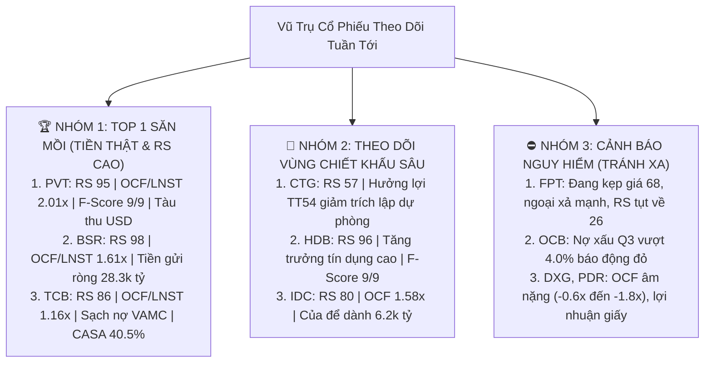

# KẾ HOẠCH TÁC CHIẾN & PHÂN BỔ ĐẦU TƯ TOÀN DIỆN TUẦN MỚI (09/11 – 13/11/2026)
## HỘI NGHỊ LIÊN PHÒNG BAN ĐẶC BIỆT — CHỦ TRÌ: MASTER CIO JAMES

* **Thời gian tổ chức**: 01:30 Sáng — Thứ Bảy, ngày 07/11/2026  
* **Chủ trì**: **Master CIO James** (Ban 8 — Tổng Tư Lệnh Điều Hành & Phân Bổ Vốn Thống Nhất)  
* **Tham dự đầy đủ 100% quân số**: 
  - Ban 10 (Hiền — BCTC & IR Scout)
  - Ban 2 VN (Kiểm toán BCTC & Forensic TT200)
  - Ban 1 VN (Vĩ mô, Chính sách SBV & Dòng tiền 3 Khối)
  - Ban 3 VN (Phòng Tổng Hợp Sàng Lọc & VSA Wyckoff)
  - Ban 4 VN (Hội Đồng Quản Trị Rủi Ro Định Lượng)
  - Ban 7 VN (Minh Quân — Chuyên Viên Thực Thi Tác Chiến)
  - Ban 9 (Victor Sentinel — Giám Sát Thời Gian Thực)
  - Ban 11 (Khánh & Bảo — Video Studio & Trending)
  - Ban 5 VN (Phòng Thẩm Định Hiệu Suất & Tự Học Thích Nghi)
* **Báo cáo trình duyệt**: **Chủ tịch Trần Quốc Thiên Phước**  
* **Quy mô vốn Quỹ hiện tại**: **`20,199,425 ₫` (100% TIỀN MẶT TƯƠI RÓI)** | **0 Cổ phiếu** | Margin: **0.0%**.

---

## PHẦN I: DỰ BÁO VĨ MÔ & KỊCH BẢN THỊ TRƯỜNG TUẦN TỚI (09/11 – 13/11)

### 1. Phân Tích Động Lực Vĩ Mô & Liên Thị Trường (Ban 1 VN Báo Cáo):
* **Cú sốc Phố Wall (Nasdaq 100 -6.4%, bốc hơi 2.500 tỷ USD)**: Lợi suất trái phiếu Mỹ 10 năm (`^TNX`) và chỉ số `DXY` tăng cao kích hoạt làn sóng chốt lời cổ phiếu công nghệ toàn cầu. Khối ngoại đã có chuỗi 10 phiên bán ròng liên tiếp tại TTCK Việt Nam (-305 tỷ ngày 06/11).
* **Chính sách bản lề trong nước — Thông tư 54/2026/TT-NHNN (Hiệu lực từ 06/11/2026)**:
  * Cho phép các khoản nợ đã bán cho VAMC được ngân hàng xem xét cho vay lại nếu có phương án khả thi.
  * Tác động tích cực tới dòng vốn tín dụng và các ngân hàng đã làm sạch 100% nợ VAMC từ trước như `TCB`, `MBB`, `CTG`.

### 2. Hai Kịch Bản Biến Động Của VN-INDEX Tuần Tới (Ban 3 VN & Ban 4 VN Dự Báo):
* **KỊCH BẢN 1 (Xác suất 70% — Kịch Bản Cơ Sở: Rũ Bỏ Sớm Về 1.700 – 1.710 Rồi Phục Hồi Cân Bằng)**:
  * Đầu tuần (Thứ Hai – Thứ Ba): Do ảnh hưởng tâm lý cuối tuần và phiên giảm -15.37 điểm của Thứ Sáu, VN-Index sẽ tiếp tục quán tính điều chỉnh nhúng về vùng hỗ trợ cứng **`1.700 – 1.710 điểm`** (vùng đáy cũ và hội tụ đường MA50).
  * Giữa đến cuối tuần (Thứ Tư – Thứ Sáu): Lực cầu bắt đáy tham gia khi định giá chiết khấu, thị trường xuất hiện các phiên 'No Supply' cạn kiệt thanh khoản và rút chân phục hồi hướng lên vùng **`1.735 – 1.745 điểm`**.
* **KỊCH BẢN 2 (Xác suất 30% — Kịch Bản Tiêu Cực: Thủng 1.700 Do Khối Ngoại Bán Ráo Riết)**:
  * Khối ngoại tiếp tục xả ròng mạnh Bluechips khiến VN-Index đánh mất mốc 1.700 điểm, lui về kiểm định vùng **`1.680 điểm`**.
  * **Hành động của Quỹ**: Kiên quyết không bắt dao rơi, tiếp tục giữ tỷ trọng tiền mặt cao để chờ tín hiệu bùng nổ theo đà (Follow-Through Day).

---

## PHẦN II: DANH MỤC SIÊU CỔ PHIẾU TIỀM NĂNG CHO TUẦN TỚI

Sau khi rà soát BCTC Q3/2026, dòng tiền OCF tiền thật và đối chiếu với các video từ profile TikTok của Chủ tịch, Hội đồng thống nhất phân loại các mã như sau:

### Bảng Thống Kê Định Lượng Top Cổ Phiếu Tiềm Năng:
| Mã CP | Thị Giá 06/11 | Sức Mạnh Giá (RS) | Dòng Tiền $OCF/LNST$ | Piotroski F-Score | Altman $Z''$-Score | Động Lực Tăng Trưởng (Key Catalysts) |
| :---: | :---: | :---: | :---: | :---: | :---: | :--- |
| **`PVT`** | 20,650 ₫ | **RS 95** | **2.01x** | **9/9** | **8.08** | Đội tàu 58 chiếc chạy quốc tế thu USD, OCF gấp đôi LNST, miễn nhiễm biến động trong nước. |
| **`BSR`** | 26,500 ₫ | **RS 98** | **1.61x** | 6/9 | **12.44** | Tiền mặt và tiền gửi ròng 28.300 tỷ VNĐ (~1.1 tỷ USD), xúc tác chuyển sàn niêm yết HOSE. |
| **`TCB`** | 21,600 ₫ | **RS 86** | **1.16x** | **9/9** | 3.51 | Hưởng lợi từ Thông tư 54 (sạch nợ VAMC), quán quân CASA 40.5%, P/B chiết khấu sâu ~1.1x. |
| **`CTG`** | 31,850 ₫ | RS 57 | **1.17x** | **9/9** | 3.24 | Giảm mạnh chi phí trích lập dự phòng sau khi làm sạch bảng cân đối, NIM phục hồi. |
| **`HDB`** | 22,100 ₫ | **RS 96** | **1.16x** | **9/9** | 3.12 | Cổ tức tiền mặt đều đặn, room tăng trưởng tín dụng cao thuộc top ngành. |

---

## PHẦN III: KẾ HOẠCH TRIỂN KHAI ĐẦU TƯ HOÀN CHỈNH (MASTER EXECUTION BLUEPRINT)

### 1. Chiến Lược Phân Bổ Vốn Kim Tự Tháp (NAV: `20,199,425 ₫`):
Hội đồng phê duyệt chiến lược **"Tấn Công Bằng Cổ Phiếu Khỏe — Phòng Thủ Bằng Tiền Mặt"**:
* **Tỷ trọng giải ngân tối đa tuần tới**: **60% - 70% NAV (tương đương 12 - 14 triệu VNĐ)**.
* **Dự phòng tiền mặt tươi (Dry Powder)**: **Luôn giữ tối thiểu 30% - 40% NAV (tương đương 6 - 8 triệu VNĐ)** để tuyệt đối không bị rơi vào thế bị động.

### 2. Sổ Lệnh Dự Kiến (Master Order Blotter) Cho Tuần Tới:

#### VỊ THẾ 1: `PVT` (Tổng Công Ty Vận Tải Dầu Khí — PVTrans) — Trọng số 45% NAV
* **Tính chất**: Cổ phiếu tăng trưởng dòng tiền USD, kiên cường nhất thị trường.
* **Vùng gom mua Kim Tự Tháp**:
  * **Nhịp 1 (Thăm dò 30% = 200 CP)**: Mua khi giá nhúng về vùng hỗ trợ **`20.00 – 20.40 ₫`** (Giá trị: ~4.080.000 ₫).
  * **Nhịp 2 (Gia tăng 40% = 200 CP)**: Mua khi test cung thành công hoặc bứt phá vượt `20.80 ₫` kèm Vol lớn (Giá trị: ~4.160.000 ₫).
  * **Tổng khối lượng dự kiến**: `400 CP` (Tổng vốn giải ngân: ~8.240.000 ₫).
* **Ngưỡng Cắt Lỗ Bắt Buộc (Stop 2xATR)**: **`19.20 ₫`** (Khóa mức lỗ $\le -5.8\%$, tương đương rủi ro chỉ **`~480.000 ₫` / ~2.3% NAV**).
* **Mục Tiêu Chốt Lời (Scaling Out 50/50)**:
  * **TP1**: **`22.50 ₫`** (+10.3%) ➔ Chốt lời 50% vị thế, nâng Stop Loss lên giá vốn.
  * **TP2**: **`24.00 ₫`** (+17.6%) ➔ Chốt lời 50% còn lại theo MA20.

#### VỊ THẾ 2: `TCB` (Ngân Hàng Kỹ Thương Việt Nam — Techcombank) — Trọng số 35% NAV
* **Tính chất**: Hưởng lợi bản lề từ Thông tư 54/2026/TT-NHNN, định giá chiết khấu đáy.
* **Vùng gom mua Kim Tự Tháp**:
  * **Nhịp 1 (Thăm dò 30% = 200 CP)**: Mua quanh vùng **`20.80 – 21.20 ₫`** khi VN-Index về 1.700 (Giá trị: ~4.200.000 ₫).
  * **Nhịp 2 (Gia tăng 40% = 100 CP)**: Mua khi dòng tiền ngoại ngừng bán ròng và kéo vượt `21.80 ₫` (Giá trị: ~2.180.000 ₫).
  * **Tổng khối lượng dự kiến**: `300 CP` (Tổng vốn giải ngân: ~6.380.000 ₫).
* **Ngưỡng Cắt Lỗ Bắt Buộc (Stop 2xATR)**: **`19.80 ₫`** (Khóa mức lỗ $\le -6.0\%$, tương đương rủi ro chỉ **`~390.000 ₫` / ~1.9% NAV**).
* **Mục Tiêu Chốt Lời (Scaling Out 50/50)**:
  * **TP1**: **`23.00 ₫`** (+8.5%) ➔ Chốt lời 50%.
  * **TP2**: **`24.50 ₫`** (+15.5%) ➔ Gồng lãi 50% còn lại.

---

## PHẦN IV: NGUYÊN TẮC KỶ LUẬT THỰC THI & PHÂN CÔNG NHIỆM VỤ

### 1. Kỷ Luật Khung Giờ Tác Chiến Của Minh Quân (Ban 7 VN):
* ⛔ **09:00 – 10:00 (Tuyệt đối KHÔNG MUA ATO)**: Không mua đuổi giá xanh sớm, tránh bẫy hưng phấn giả tạo.
* 👁️ **13:00 – 13:45**: Theo dõi áp lực hàng T+2 xả ra thị trường.
* 🎯 **14:00 – 14:25 (KHUNG GIỜ VÀNG BẤM CÒ)**: Chỉ giải ngân khi:
  1. VN-Index xuất hiện nến rút chân rõ nét tại vùng hỗ trợ 1.700 – 1.710 điểm.
  2. Tỷ lệ lệnh Mua chủ động (Buy Up) của cổ phiếu đạt $\ge 65\%$.
  3. Sử dụng lệnh LO (Limit Order) 100% thời gian, tuyệt đối không dùng lệnh thị trường MP.

### 2. Phân Công Nhiệm Vụ 11 Phòng Ban:
* **Ban 10 (Hiền)**: Theo dõi sát sao các văn bản hướng dẫn tiếp theo của SBV về Thông tư 54 và rà soát báo cáo giải trình nợ xấu của các ngân hàng.
* **Ban 2 VN**: Cập nhật chỉ số Forensic Beneish M và Altman Z cho các mã mới.
* **Ban 1 VN**: Giám sát dòng tiền ngoại và biến động Phố Wall mỗi sáng lúc 07:30.
* **Ban 3 VN**: Soi bảng điện VSA tìm nến Test Cung của PVT và TCB.
* **Ban 4 VN**: Kiểm tra điều kiện Position Sizing, đảm bảo tổng rủi ro nếu chạm Stop Loss không vượt quá 1.5% NAV.
* **Ban 7 VN (Minh Quân)**: Bấm cò thực thi chính xác từng lô 100 CP.
* **Ban 9 (Victor Sentinel)**: Trực chiến streaming bảng điện, phát còi báo động nếu có biến động bất thường.
* **Ban 11 (Khánh & Bảo)**: Triển khai kịch bản video TikTok 60s phân tích Thông tư 54 nợ VAMC phục vụ kênh iCopy của Chủ tịch.
* **Ban 5 VN**: Lưu trữ snapshot và đo lường tỷ lệ thắng (Hit Rate %).
* **Master CIO James**: Tổng chỉ huy, báo cáo trực tiếp 2 lần/ngày tới Chủ tịch Phước Trần.
