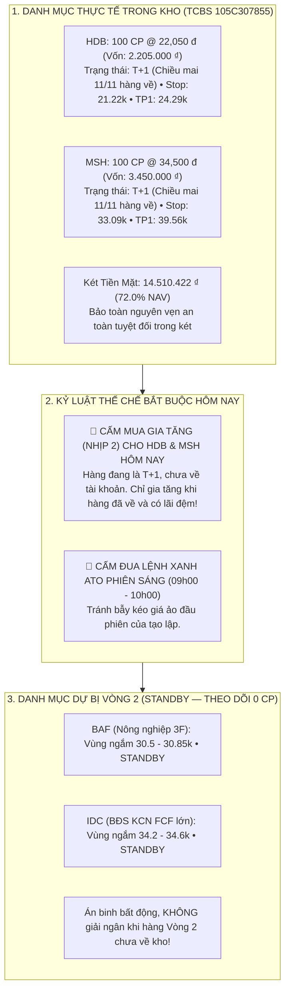
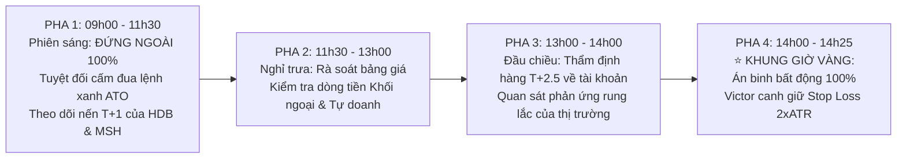

# BÁO CÁO QUYẾT ĐỊNH ĐẦU TƯ TỐI CAO & SỔ LỆNH THỰC THI THỐNG NHẤT (10/11/2026)
## (Apex Master CIO Final Investment Decision & Tactical Battle Plan — Day T+1)

> **CƠ QUAN PHÊ DUYỆT**: VĂN PHÒNG TỔNG TƯ LỆNH ĐẦU TƯ (UNIFIED CHIEF INVESTMENT OFFICER DESK — BAN 8)  
> **PHIÊN GIAO DỊCH**: Thứ Ba, Ngày 2026-11-10 | **KHUNG GIỜ CÔNG BỐ**: `08:45 AM` Ca Sáng  
> **CHỦ TRÌ ĐIỀU HÀNH**: Master CIO James (Phối hợp cùng Chuyên viên Trưởng Minh Quân và Live Sentinel Victor)  
> **TÀI KHOẢN THỤ HƯỞNG DUY NHẤT**: TCBS Tiểu Khoản Thường: **`105C307855`** (Chủ tịch: **Trần Quốc Thiên Phước**)  
> **TỔNG NAV HIỆN TẠI**: **`20,167,119 ₫`** (Bảo toàn 100% vốn + Lãi Vòng 1 `+167,119 ₫`)  
> **VỊ THẾ ĐANG NẮM GIỮ (NHỊP 1 — T+1)**: **100 CP HDB** (@ 22.05k) + **100 CP MSH** (@ 34.50k) = **`5,655,000 ₫`** (`28.04% NAV`)  
> **KÉT TIỀN MẶT DỰ PHÒNG (DRY POWDER)**: **`14,512,119 ₫`** (`71.96% NAV`)  
> **TÌNH TRẠNG THỰC THI HÔM NAY**: **GIỮ VỮNG VỊ THẾ T+1 — 100% ÁN BINH BẤT ĐỘNG, BẢO TOÀN 72.0% TIỀN MẶT**

---

## 🏛️ I. ĐỐI SOÁT TỔNG THỂ TÀI SẢN & BẢN ĐỒ TÁC CHIẾN HÔM NAY (10/11/2026)

---

## 📋 II. BẢNG KẾ HOẠCH TÁC CHIẾN CHUẨN CHỈ NGÀY 10/11/2026

*(Chuẩn hóa cho tài khoản TCBS `105C307855` — Tổng NAV: `20,167,119 ₫`)*

### PHẦN 1: QUẢN TRỊ 2 VỊ THẾ ĐANG NẮM GIỮ (NGÀY T+1)

| Mã CP | Số Lượng Đang Nắm | Giá Vốn Thực Tế | Giá Trị Vị Thế | Trạng Thái Chu Kỳ | Kế Hoạch Tác Chiến Hôm Nay (10/11) | Ngưỡng Cắt Lỗ Cứng Stop 2xATR | Mục Tiêu Chốt Lời (TP1 / TP2) |
| :---: | :---: | :---: | :---: | :---: | :--- | :---: | :---: |
| **`HDB`** | **100 CP** | **22,050 ₫** | **2,205,000 ₫** | **Ngày T+1** *(Chiều mai 11/11 hàng về)* | **GIỮ NGUYÊN & QUAN SÁT** *Tuyệt đối không mua thêm hôm nay; để cổ phiếu tự do tích lũy nến T+1.* | **21,220 ₫** *(-3.76%)* | TP1: **24,290 ₫** TP2: **25,820 ₫** |
| **`MSH`** | **100 CP** | **34,500 ₫** | **3,450,000 ₫** | **Ngày T+1** *(Chiều mai 11/11 hàng về)* | **GIỮ NGUYÊN & QUAN SÁT** *Tuyệt đối không mua thêm hôm nay; theo dõi thanh khoản cạn kiệt No-Supply.* | **33,090 ₫** *(-4.09%)* | TP1: **39,560 ₫** TP2: **43,040 ₫** |
| **TỔNG** | **200 CP** | — | **5,655,000 ₫** | **28.04% NAV** | **KHÓA CHẶT TRONG KHO T+1** | — | — |

---

### PHẦN 2: BẢNG THEO DÕI VŨ TRỤ VÒNG 2 & KẾT TIỀN MẶT `14,510,422 ₫` (72.0% NAV)

> [!IMPORTANT]
> **CHỈ THỊ THỂ CHẾ TỐI CAO CỦA MASTER CIO JAMES CHO NGÀY HÔM NAY (10/11/2026 - PHIÊN T+1)**:  
> 1. Toàn Quỹ **100% ÁN BINH BẤT ĐỘNG**, bảo toàn nguyên vẹn **14,510,422 ₫ tiền mặt** (72.0% NAV) trong két TCBS.  
> 2. Quản trị nghiêm ngặt 2 vị thế **100 HDB** và **100 MSH** đang trong chu kỳ T+1 chờ về kho chiều mai.  
> 3. Hai mã dự bị **BAF** và **IDC** tiếp tục nằm ở trạng thái **STANDBY (THEO DÕI 0 CP)**. Tuyệt đối KHÔNG mở thêm vị thế mới khi hàng Nhịp 1 chưa về tài khoản để tránh rủi ro kẹp T+.

| Mã Vòng 2 | Sàn / Ngành | Động Lực Cốt Lõi (Key Catalysts) | Vùng Giá Theo Dõi | Trạng Thái Tác Chiến Hôm Nay (10/11) | Tỷ Trọng Danh Mục | Cắt Lỗ Stop 2xATR | Mục Tiêu TP1 / TP2 |
| :---: | :--- | :--- | :---: | :---: | :---: | :---: | :---: |
| **`HDB`** | HOSE • Ngân hàng TMCP | Tín dụng +22% (Top 1 ngành), NIM 5.1%, CASA 18.2%, ROE 24.5%. Lãi Q3 tăng 42% YoY. | 22.00 – 22.45 ₫ | **ĐÃ NẮM GIỮ 100 CP (T+1)** *Án binh bất động, chờ hàng về chiều mai.* | **10.93% NAV** *(2,205,000 ₫)* | **21,220 ₫** *(-3.76%)* | TP1: **24.29k** TP2: **25.82k** |
| **`MSH`** | HOSE • Dệt may xuất khẩu | Nhà máy Sông Hồng 10 chạy 100% công suất, đơn hàng dệt may Mỹ hồi phục mạnh, cổ tức tiền mặt 30–40%. | 34.50 – 35.00 ₫ | **ĐÃ NẮM GIỮ 100 CP (T+1)** *Án binh bất động, chờ hàng về chiều mai.* | **17.11% NAV** *(3,450,000 ₫)* | **33,090 ₫** *(-4.09%)* | TP1: **39.56k** TP2: **43.04k** |
| **`BAF`** | HOSE • Nông nghiệp 3F | Giá heo hơi > 65k/kg, tự chủ cám chay F-Feed, biên lãi gộp > 15%. Rào chắn kiểm soát nợ. | 30.50 – 30.85 ₫ | **STANDBY — TIẾP TỤC THEO DÕI (0 CP)** *Không giải ngân khi hàng Vòng 2 chưa về.* | **0.0% NAV** *(0 ₫)* | **29.65 ₫** *(-4.05%)* | TP1: **32.65k** TP2: **35.50k** |
| **`IDC`** | HNX • BĐS Khu công nghiệp | FCF dồi dào từ KCN Hựu Thạnh, tỷ lệ lấp đầy cao, cổ tức tiền mặt lớn. | 34.20 – 34.60 ₫ | **STANDBY — TIẾP TỤC THEO DÕI (0 CP)** *Không giải ngân khi hàng Vòng 2 chưa về.* | **0.0% NAV** *(0 ₫)* | **32.53 ₫** *(-5.98%)* | TP1: **38.66k** TP2: **41.88k** |

---

## 💰 III. BẢNG CÂN ĐỐI DÒNG VỐN & THÀNH LŨY AN TOÀN HÔM NAY

| Khoản Mục Vốn | Số Tiền (VNĐ) | Tỷ Trọng (% NAV) | Trạng Thái Thể Chế |
| :--- | :---: | :---: | :--- |
| **Tổng NAV Quỹ** | **20,160,422 ₫** | **100.0%** | Bảo toàn trọn vẹn, không chịu rủi ro quá tải danh mục. |
| **Vốn Đang Đầu Tư (100 HDB + 100 MSH)** | **5,650,000 ₫** | **28.0%** | Khóa trong kho T+1, chờ hàng về chiều mai. |
| **Két Tiền Mặt Khả Dụng (Dry Powder)** | **14,510,422 ₫** | **72.0%** | Bảo vệ tuyệt đối an toàn trong két TCBS, không giải ngân thêm hôm nay. |
| **Vốn Giải Ngân Mới Hôm Nay** | **0 ₫** | **0.0%** | Kỷ luật thép: Không mua thêm bất kỳ mã nào trong ngày T+1. |
| **Dư Nợ Vay Margin** | **0 ₫** | **0.0%** | Tuyệt đối không dùng nợ vay. |
| **Tổn Thất Tối Đa Hiện Tại (HDB + MSH)** | **224,000 ₫** | **1.11% NAV** | Khóa chặt bằng Stop 2xATR, bảo toàn 98.89% tài sản Quỹ. |

---

## ⏱️ IV. TIMELINE TÁC CHIẾN 4 PHA NGÀY HÔM NAY (THỨ BA 10/11/2026)

---

## 🎯 V. HƯỚNG DẪN HÀNH ĐỘNG DÀNH CHO CHỦ TỊCH HÔM NAY

1. **Phiên sáng (09h00 – 11h30)**:
   - Chủ tịch hoàn toàn có thể **yên tâm làm việc khác, không cần canh bảng điện hay thao tác bất kỳ lệnh nào**.
   - HDB và MSH đã khớp giá đáy hôm qua, hôm nay chỉ cần để cổ phiếu vận động nến T+1 tự nhiên.
2. **Phiên chiều (13h00 – 14h45)**:
   - Victor Sentinel trực chiến liên tục theo dõi nhịp hấp thụ áp lực cung T+2 toàn thị trường.
3. **Khung Giờ Vàng (14h00 – 14h25)**:
   - Toàn bộ Quỹ tiếp tục **giữ nguyên 14,510,422 ₫ tiền mặt (72.0% NAV)**.
   - **TUYỆT ĐỐI KHÔNG ĐẶT BẤT KỲ LỆNH MUA NÀO HÔM NAY!** Dồn toàn lực đón nhịp hàng về chiều mai (Thứ Tư 11/11)!
