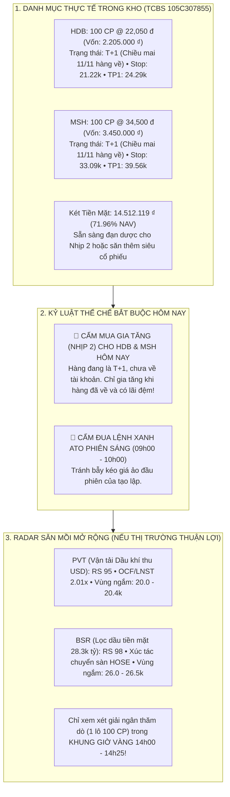
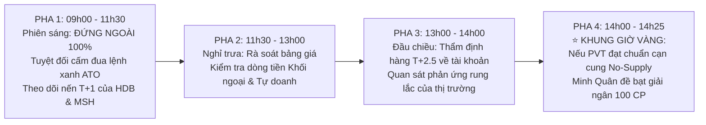

# BÁO CÁO QUYẾT ĐỊNH ĐẦU TƯ TỐI CAO & SỔ LỆNH THỰC THI THỐNG NHẤT (10/11/2026)
## (Apex Master CIO Final Investment Decision & Tactical Battle Plan — Day T+1)

> **CƠ QUAN PHÊ DUYỆT**: VĂN PHÒNG TỔNG TƯ LỆNH ĐẦU TƯ (UNIFIED CHIEF INVESTMENT OFFICER DESK — BAN 8)  
> **PHIÊN GIAO DỊCH**: Thứ Ba, Ngày 2026-11-10 | **KHUNG GIỜ CÔNG BỐ**: `08:45 AM` Ca Sáng  
> **CHỦ TRÌ ĐIỀU HÀNH**: Master CIO James (Phối hợp cùng Chuyên viên Trưởng Minh Quân và Live Sentinel Victor)  
> **TÀI KHOẢN THỤ HƯỞNG DUY NHẤT**: TCBS Tiểu Khoản Thường: **`105C307855`** (Chủ tịch: **Trần Quốc Thiên Phước**)  
> **TỔNG NAV HIỆN TẠI**: **`20,167,119 ₫`** (Bảo toàn 100% vốn + Lãi Vòng 1 `+167,119 ₫`)  
> **VỊ THẾ ĐANG NẮM GIỮ (NHỊP 1 — T+1)**: **100 CP HDB** (@ 22.05k) + **100 CP MSH** (@ 34.50k) = **`5,655,000 ₫`** (`28.04% NAV`)  
> **KÉT TIỀN MẶT DỰ PHÒNG (DRY POWDER)**: **`14,512,119 ₫`** (`71.96% NAV`)  
> **TÌNH TRẠNG THỰC THI HÔM NAY**: **GIỮ VỮNG VỊ THẾ T+1 — THEO DÕI RADAR SĂN MỒI PVT/BSR CHO KHUNG GIỜ VÀNG**

---

## 🏛️ I. ĐỐI SOÁT TỔNG THỂ TÀI SẢN & BẢN ĐỒ TÁC CHIẾN HÔM NAY (10/11/2026)

---

## 📋 II. BẢNG KẾ HOẠCH TÁC CHIẾN CHUẨN CHỈ NGÀY 10/11/2026

*(Chuẩn hóa cho tài khoản TCBS `105C307855` — Tổng NAV: `20,167,119 ₫`)*

### PHẦN 1: QUẢN TRỊ 2 VỊ THẾ ĐANG NẮM GIỮ (NGÀY T+1)

| Mã CP | Số Lượng Đang Nắm | Giá Vốn Thực Tế | Giá Trị Vị Thế | Trạng Thái Chu Kỳ | Kế Hoạch Tác Chiến Hôm Nay (10/11) | Ngưỡng Cắt Lỗ Cứng Stop 2xATR | Mục Tiêu Chốt Lời (TP1 / TP2) |
| :---: | :---: | :---: | :---: | :---: | :--- | :---: | :---: |
| **`HDB`** | **100 CP** | **22,050 ₫** | **2,205,000 ₫** | **Ngày T+1** *(Chiều mai 11/11 hàng về)* | **GIỮ NGUYÊN & QUAN SÁT** *Tuyệt đối không mua thêm hôm nay; để cổ phiếu tự do tích lũy nến T+1.* | **21,220 ₫** *(-3.76%)* | TP1: **24,290 ₫** TP2: **25,820 ₫** |
| **`MSH`** | **100 CP** | **34,500 ₫** | **3,450,000 ₫** | **Ngày T+1** *(Chiều mai 11/11 hàng về)* | **GIỮ NGUYÊN & QUAN SÁT** *Tuyệt đối không mua thêm hôm nay; theo dõi thanh khoản cạn kiệt No-Supply.* | **33,090 ₫** *(-4.09%)* | TP1: **39,560 ₫** TP2: **43,040 ₫** |
| **TỔNG** | **200 CP** | — | **5,655,000 ₫** | **28.04% NAV** | **KHÓA CHẶT TRONG KHO T+1** | — | — |

---

### PHẦN 2: RADAR SĂN MỒI TỪ KÉT TIỀN MẶT `14,512,119 ₫` (KHUNG GIỜ VÀNG 14h00 – 14h25)

> [!NOTE]
> **ĐIỀU KIỆN KÍCH HOẠT DUY NHẤT**:  
> Quỹ chỉ xem xét giải ngân thêm **1 vị thế thăm dò (1 lô 100 CP)** từ két 14.5M tiền mặt NẾU thị trường phiên chiều xuất hiện tín hiệu cạn cung No-Supply chuẩn VSA hoặc dòng tiền lớn bùng nổ rõ rệt.  
> Nếu thị trường rung lắc hoặc chưa có điểm Pivot an toàn: **KIÊN QUYẾT GIỮ NGUYÊN 14.51M TIỀN MẶT**, không giải ngân bừa bãi!

| Mã Radar | Sàn / Ngành | Động Lực Cốt Lõi (Key Catalysts) | Vùng Giá Theo Dõi | LỆNH DỰ KIẾN (CHỈ KÍCH HOẠT NẾU ĐẠT CHUẨN 14h00) | Vốn Dự Kiến | Cắt Lỗ Stop 2xATR | Mục Tiêu TP1 |
| :---: | :--- | :--- | :---: | :---: | :---: | :---: | :---: |
| **`PVT`** | HOSE • Vận tải dầu khí | Đội tàu 58 chiếc chạy quốc tế thu USD, OCF/LNST 2.01x (gấp đôi LNST), RS 95, P/E hấp dẫn. | 20.00 – 20.40 ₫ | **100 CP (Lô chẵn 100)** *Đặt lệnh LO: 20.10 – 20.35 ₫* | **~2,030,000 ₫** *(10.0% NAV)* | **19.20 ₫** *(-5.4%)* | **22.50 ₫** *(+10.8%)* |
| **`BSR`** | UPCoM • Lọc hóa dầu | Thặng dư tiền mặt 28.300 tỷ VNĐ (~1.1 tỷ USD), RS 98, xúc tác chuyển sàn HOSE. | 26.00 – 26.50 ₫ | **100 CP (Lô chẵn 100)** *Chỉ xem xét nếu PVT không đạt chuẩn* | **~2,630,000 ₫** *(13.0% NAV)* | **24.50 ₫** *(-6.8%)* | **29.50 ₫** *(+12.1%)* |
| **`BAF` & `IDC`** | HOSE / HNX | Nông nghiệp 3F & BĐS Khu công nghiệp | — | **STANDBY — TIẾP TỤC THEO DÕI (0 CP)** | **0 ₫** | — | — |

---

## 💰 III. BẢNG CÂN ĐỐI DÒNG VỐN & THÀNH LŨY AN TOÀN HÔM NAY

| Khoản Mục Vốn | Số Tiền (VNĐ) | Tỷ Trọng (% NAV) | Trạng Thái Thể Chế |
| :--- | :---: | :---: | :--- |
| **Tổng NAV Quỹ** | **20,167,119 ₫** | **100.0%** | Bảo toàn trọn vẹn, không chịu rủi ro quá tải danh mục. |
| **Vốn Đang Đầu Tư (HDB + MSH Nhịp 1)** | **5,655,000 ₫** | **28.04%** | Khóa trong kho T+1, chờ hàng về chiều mai. |
| **Két Tiền Mặt Giữ Lại (Dry Powder)** | **14,512,119 ₫** | **71.96%** | Đạn sẵn sàng cho Nhịp 2 hoặc săn thêm mã mới. |
| **Vốn Giải Ngân Tối Đa Hôm Nay (Nếu Mua PVT)** | **~2,030,000 ₫** | **~10.0%** | Khống chế tổng mức giải ngân toàn Quỹ $\le 38\%$ NAV. |
| **Dư Nợ Vay Margin** | **0 ₫** | **0.0%** | Tuyệt đối không dùng nợ vay. |
| **Tổn Thất Tối Đa Hiện Tại (HDB + MSH)** | **224,000 ₫** | **1.11% NAV** | Khóa chặt bằng Stop 2xATR, bảo toàn 98.89% tài sản Quỹ. |

---

## ⏱️ IV. TIMELINE TÁC CHIẾN 4 PHA NGÀY HÔM NAY (THỨ BA 10/11/2026)

---

## 🎯 V. HƯỚNG DẪN HÀNH ĐỘNG DÀNH CHO CHỦ TỊCH HÔM NAY

1. **Phiên sáng (09h00 – 11h30)**:
   - Chủ tịch hoàn toàn có thể **yên tâm làm việc khác, không cần canh bảng điện hay thao tác bất kỳ lệnh nào**.
   - HDB và MSH đã khớp giá đáy hôm qua, hôm nay chỉ cần để cổ phiếu vận động nến T+1 tự nhiên.
2. **Phiên chiều (13h00 – 14h00)**:
   - Victor Sentinel sẽ trực chiến liên tục theo dõi nhịp hấp thụ của thị trường.
3. **Trước Khung Giờ Vàng (13h55)**:
   - James và Minh Quân sẽ báo cáo trực tiếp tình hình thị trường:
     - Nếu `PVT` xuất hiện điểm mua Pivot đẹp: James sẽ đề bạt Chủ tịch mở app TCBS nhập 1 lệnh LO thăm dò **100 CP PVT** (~2.03 triệu).
     - Nếu thị trường chưa đạt chuẩn: Toàn bộ Quỹ tiếp tục **giữ nguyên 14.51 triệu tiền mặt** để dồn lực đón nhịp hàng về chiều mai (Thứ Tư 11/11)!
