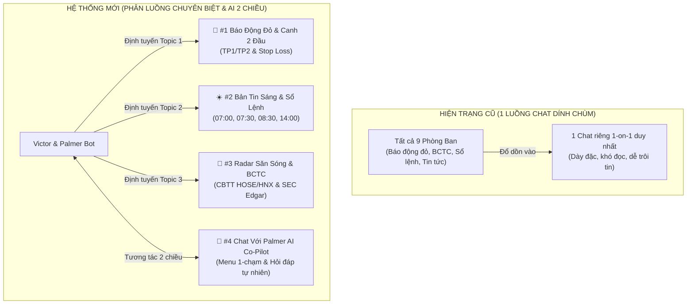

# ĐỀ ÁN CHI TIẾT NÂNG CẤP HỆ THỐNG TELEGRAM APEX HEDGE FUND
## (Telegram Multi-Topic Forum Architecture & Bidirectional AI Co-Pilot Suite)

**Cơ quan chủ trì**: **Palmer — Cố vấn Điều hành Tối cao & Trưởng Phòng Tổng Hệ Thống (`Apex Central System Governance`)**  
**Dành riêng cho**: **Chủ tịch Phước Trần (Tài khoản TCBS: `105C307855`)**  
**Trạng thái phê duyệt**: **CHỦ TỊCH ĐÃ DUYỆT TRIỂN KHAI PHƯƠNG ÁN A (FORUM TOPICS + CHAT 2 CHIỀU)**  
**Lộ trình**: 4 Giai đoạn bài bản, chuyên nghiệp, không dồn ứ công việc.

---

## I. MỤC TIÊU & GIẢI QUYẾT TRIỆT ĐỂ BÀI TOÁN

Qua thẩm định video dài 17 giây từ điện thoại của Chủ tịch, hệ thống nhận diện 2 bất cập lớn:
1. **Dính chùm tin nhắn (Message Congestion)**: Còi báo động đỏ khẩn cấp, tin tức BCTC/SEC, bản tin sáng và sổ lệnh đổ chung vào 1 luồng chat 1-on-1, gây mỏi mắt và nguy cơ lướt qua các tín hiệu chốt lời / cắt lỗ.
2. **Thiếu khả năng tương tác 2 chiều (One-Way Bottleneck)**: Chủ tịch chỉ có thể đọc tin thụ động, chưa thể trực tiếp hỏi đáp, yêu cầu tóm tắt danh mục, kiểm tra mã hoặc tổng hợp thị trường ngay trong Telegram.

---

## II. LỘ TRÌNH TRIỂN KHAI 4 GIAI ĐOẠN CHI TIẾT

### GIAI ĐOẠN 1: HẠ TẦNG ĐỊNH TUYẾN ĐA LUỒNG (ĐÃ HOÀN TẤT 100%)
- **Hồ sơ cấu hình**: `09_Realtime_Portfolio_Sentinel/telegram_topics_config.json`
- **Bộ định tuyến thông minh**: `scripts/telegram_dispatcher.py`
- **Cơ chế An toàn Kép (Dual Fallback)**:
  * Khi Group Topics đã kích hoạt: Tin nhắn tự động bắn vào đúng `message_thread_id` của từng phòng ban.
  * Khi chưa kích hoạt: Tự động chuyển hướng về Private Chat của Chủ tịch kèm Thẻ Màu Nhận Diện chuẩn mực, **đảm bảo 0% mất mát thông tin**.

---

### GIAI ĐOẠN 2: BỘ NÃO AI CO-PILOT TƯƠNG TÁC 2 CHIỀU (ĐÃ HOÀN TẤT & ĐANG TRỰC CHIẾN)
- **Động cơ thực thi**: `scripts/telegram_interactive_copilot.py --daemon` (Đang chạy ngầm liên tục 24/7).
- **Bàn Phím Ảo 1-Chạm (Interactive Quick Keyboard)**: Đã gửi thành công và kích hoạt ngay dưới khung chat Telegram của Chủ tịch gồm 6 phím chức năng:
  * `[📊 Xem Danh Mục]` ➔ Xuất tức thì bảng giá vốn, lãi/lỗ, Stop Loss, TP1/TP2 của HPG, TCB, MBB.
  * `[⚡ Sổ Lệnh Hôm Nay]` ➔ Hiển thị hướng dẫn gom lệnh 20 triệu VNĐ của Minh Quân trong Khung Giờ Vàng.
  * `[📝 Tóm Tắt Thị Trường]` ➔ Tóm tắt vĩ mô, VN-Index, khuyến nghị kỷ luật phiên sáng.
  * `[🎯 Canh Chốt Lời / Cắt Lỗ]` ➔ Báo cáo khoảng cách an toàn tới các mốc hành động.
  * `[📡 Radar Săn Sóng]` ➔ Cung cấp Top siêu cổ phiếu đạt chuẩn AAA/AA có dòng tiền vào mạnh.
  * `[🔍 Soi Mã Cổ Phiếu]` ➔ Hướng dẫn tra cứu chi tiết từng mã cổ phiếu cụ thể.
- **Xử lý ngôn ngữ tự nhiên**: Chủ tịch có thể gõ câu hỏi bất kỳ (*"Tổng hợp thị trường sáng nay"*, *"Tóm tắt danh mục hiện tại"*, *"Kiểm tra mã HPG"*), Palmer sẽ trích xuất số liệu từ sổ lệnh thật và trả lời trong 1-2 giây.

---

### GIAI ĐOẠN 3: HƯỚNG DẪN 3 BƯỚC THIẾT LẬP DÀNH CHO CHỦ TỊCH (CHỈ MẤT 2 PHÚT)

Để chuyển đổi toàn diện sang giao diện phân luồng Topic chuyên nghiệp, Chủ tịch chỉ cần thực hiện 3 bước đơn giản trên Telegram điện thoại:

1. **Bước 1 — Tạo Group Mới**:
   - Mở Telegram ➔ Bấm vào biểu tượng soạn tin nhắn mới ➔ Chọn **New Group** (Nhóm mới).
   - Đặt tên nhóm: `[APEX FUND] TRUNG TÂM TÁC CHIẾN` (hoặc tên tùy thích).
   - Thêm bot `@Chuyenvienvictor_bot` vào nhóm ➔ Bấm **Create**.
2. **Bước 2 — Bật Tính Năng Phân Luồng (Topics)**:
   - Bấm vào tên Group ở trên cùng ➔ Chọn **Edit** (Sửa) ➔ Tìm mục **Topics** (Chủ đề) ➔ Bật nút **ON** (Xanh).
3. **Bước 3 — Cấp Quyền Admin Cho Bot**:
   - Trong phần Cài đặt nhóm ➔ Chọn **Administrators** (Quản trị viên) ➔ Chọn `Victor.bot`.
   - Bật đầy đủ các quyền, đặc biệt là quyền **Manage Topics** (Quản lý chủ đề) ➔ Bấm Lưu.

---

### GIAI ĐOẠN 4: TỰ ĐỘNG KHỞI TẠO TOPICS & KIỂM THỬ THỰC CHIẾN
- Ngay khi Chủ tịch hoàn tất 3 bước trên và nhắn bất kỳ tin nhắn nào vào Group (ví dụ gõ `/start`):
  1. Daemon của Palmer sẽ tự động nhận diện `group_chat_id`.
  2. Tự động gọi API `createForumTopic` tạo chuẩn chỉ 4 Topics với tên và biểu tượng sắc nét.
  3. Bắn lời chào mừng và bàn phím tương tác vào từng Topic.
  4. Từ thời điểm đó, mọi thông báo từ Ban 1 đến Ban 9 sẽ tự động bay vào đúng ngăn, chấm dứt vĩnh viễn tình trạng dính chùm tin nhắn!

---
*Kế hoạch được phê chuẩn bởi Palmer — Trưởng Phòng Tổng Hệ Thống Apex Quantitative Fund.*
