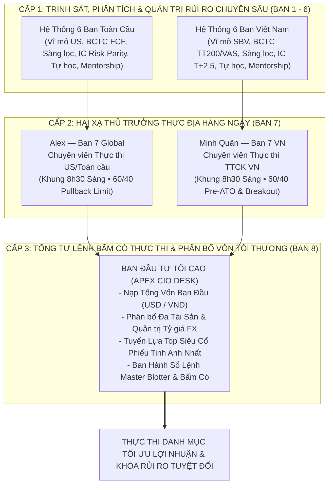

# Ban Đầu Tư Tối Cao — Tổng Tư Lệnh Điều Hành & Phân Bổ Vốn Thống Nhất Toàn Cầu & Việt Nam
## (Unified Chief Investment Officer - "Apex CIO Master Execution Desk")

> **"Phòng ban này là khẩu súng của chúng ta: Nạp đạn chuẩn xác, ngắm bắn khoa học và bóp cò dứt khoát dựa trên toàn bộ trí tuệ của 14 phòng ban chuyên môn."**

---

## 1. Vị Trí Chiến Lược Trong Toàn Bộ Hệ Thống

Hệ thống Quỹ Đầu Tư Định Lượng & Cơ Bản Đa Tầng vận hành theo kiến trúc 3 cấp độ:

---

## 2. Nhiệm Vụ Cốt Lõi Của Master CIO Desk

1. **Tổng Hợp Toàn Bộ Báo Cáo Kinh Doanh & Báo Cáo Tài Chính 2 Đội Nhóm**:
   - Đối chiếu sức khỏe cỗ máy in tiền $FCF$ của các tập đoàn đa quốc gia Mỹ với chất lượng lợi nhuận thực $OCF / LNST$, $Altman\ Z''$, và $Beneish\ M$ của doanh nghiệp Việt Nam.
   - Kiểm tra lịch sự kiện: Cấm giải ngân trước mùa BCTC ($\le 7$ ngày), chỉ gom hàng khi doanh nghiệp đã công bố kết quả vượt trội và an toàn.

2. **Hội Nghị Giao Ban Cấp Cao — Điều Phối Alex & Minh Quân**:
   - Chất vấn chéo giữa Alex (thế mạnh vĩ mô toàn cầu, dòng tiền Big Tech, rủi ro lãi suất Fed, dầu khí, bán dẫn) và Minh Quân (thế mạnh thanh khoản nội địa, chính sách SBV, chu kỳ thanh toán T+2.5, biên độ sàn HOSE +/-7%, dòng tiền ngoại bán ròng vs cá nhân mua ròng).
   - Đưa ra quyết định hòa giải: Khi nào nên tăng tỷ trọng sang Mỹ để trú ẩn lạm phát/tỷ giá, khi nào nên dồn lực về Việt Nam để đón sóng nâng hạng và nới lỏng tiền tệ.

3. **Thuật Toán Phân Bổ Vốn Ban Đầu Khoa Học (Dynamic Capital Allocation)**:
   - **Đầu vào**: Tổng số vốn đầu tư ban đầu của Nhà đầu tư ($V_0$ bằng USD hoặc VNĐ).
   - **Tầng 1 (Liên Thị Trường)**: $55\%$ Global Portfolio (USD) + $35\%$ Vietnam Portfolio (VND) + $10\%$ Tiền Mặt / Buffer Dry Powder.
   - **Tầng 2 (Nhánh Chiến Lược)**: $65\%$ Core Compounder (Cổ phiếu trụ cột độc quyền, ROE cao, nợ thấp) + $35\%$ Tactical Alpha (Cổ phiếu bứt phá tăng tốc, catalysts bùng nổ).
   - **Tầng 3 (Từng Vị Thế Định Lượng)**: Định cỡ vị thế theo mô hình $ATR\ Risk-Parity$ kết hợp $Kelly\ Criterion$:
     $$\text{Capital Allocation}_i = \min\left(\text{Cap}_{\max}, \frac{\text{Risk Budget} \times NAV}{\text{Distance to Stop Loss (2xATR)}}\right)$$
   - Đảm bảo: Nếu bất kỳ cổ phiếu nào chạm ngưỡng Stop Loss 2xATR, khoản lỗ **không bao giờ vượt quá $0.35\%$ Tổng NAV**.

4. **Sàng Lọc Danh Mục Tối Thượng (Apex Alpha Selection)**:
   - Tuyển lựa Top 6 - 8 siêu cổ phiếu xuất sắc nhất toàn cầu và Việt Nam hội tụ điểm số **Apex Multi-Factor Score $\ge 80/100$**.
   - Bắt buộc đạt: Kỳ vọng toán học $EV\% > 0$ và Tỷ lệ $Risk/Reward \ge 1:2.0$.

5. **Lập Sổ Lệnh Thực Thi Master Blotter & Lộ Trình Bấm Cò**:
   - Quy định rõ ràng: Mã CP, Sàn, Số lượng cổ phiếu, Giá vào lệnh từng nhịp, Ngưỡng cắt lỗ cứng, Mốc chốt lời TP1 / TP2, và Kế hoạch xử lý khi thị trường biến động ngược dự báo.

---

## 3. Cấu Trúc Hồ Sơ & File Đầu Ra

- `master_capital_config.json`: Cấu hình tỷ trọng, tỷ giá, trần rủi ro và tổng vốn ban đầu.
- `YYYY-MM-DD_Master_CIO_Final_Decision.md`: Báo cáo Quyết định Đầu tư Tối cao hàng ngày.
- `master_execution_blotter.json`: Sổ lệnh Master định dạng JSON chuẩn bị nạp vào broker/trading desk.
