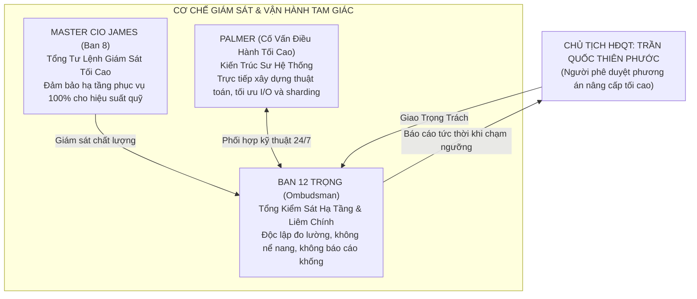

# 🏛️ NGHỊ QUYẾT THỂ CHẾ VỀ VIỆC GIAO TRỌNG TRÁCH TỔNG GIÁM SÁT HẠ TẦNG, SỨC CHỨA & NGƯỠNG NÂNG CẤP HỆ THỐNG
## BAN 12 TRỌNG (OMBUDSMAN) & CỐ VẤN TỐI CAO PALMER — DƯỚI SỰ GIÁM SÁT CỦA MASTER CIO JAMES

> **NGƯỜI BAN HÀNH CHỈ THỊ:** Chủ Tịch Hội Đồng Quản Trị — **Trần Quốc Thiên Phước**  
> **CƠ QUAN THỤ LÝ & THỰC THI:** Ban 12 Trọng (Tổng Kiểm Sát Thể Chế) phối hợp cùng Palmer (Cố Vấn Tối Cao & Trưởng Phòng Tổng Hệ Thống)  
> **CƠ QUAN GIÁM SÁT THỰC THI:** Master CIO James (Ban 8)  
> **THỜI ĐIỂM HIỆU LỰC:** `15:35:00 Chủ Nhật, ngày 08/11/2026` *(Có giá trị thi hành vĩnh viễn xuyên suốt vòng đời Quỹ)*  
> **MÃ NGUỒN ĐỘNG CƠ GIÁM SÁT THỰC TẾ:** [scripts/trong_infrastructure_sentinel.py](file:///c:/Users/phuoc/Downloads/antigravity/Chứng%20khoán/scripts/trong_infrastructure_sentinel.py)  
> **SỔ CÁI TELEMETRY TẬP TRUNG:** [data/infrastructure_health_telemetry.json](file:///c:/Users/phuoc/Downloads/antigravity/Chứng%20khoán/data/infrastructure_health_telemetry.json)

---

## I. NỘI DUNG SẮC LỆNH CHỦ TỊCH & PHÂN ĐỊNH TRÁCH NHIỆM

Chấp hành chỉ đạo trực tiếp từ Chủ tịch HĐQT Trần Quốc Thiên Phước:
> *"Vậy công việc giám sát tình trạng của hệ thống này tôi giao luôn cho Trọng nhé, trách nhiệm này thật sự to lớn đấy nên phải làm thật sự và làm có tính chuyên môn cao nhất, hãy luôn giám sát xem nếu hệ thống đã đạt ngưỡng cần nâng cấp cơ sở hạ tầng để tránh tình trạng quá tải hoặc gì đó thì phải báo cáo ngay. Riêng công việc này thì bạn hãy phối hợp với Trọng qua sự giám sát của James nhé, hãy thực hiện công việc này thật hoàn chỉnh."*

Hội đồng Thể chế chính thức xác lập cấu trúc tam giác quyền lực quản trị rủi ro hạ tầng:

---

## II. QUY TRÌNH KIỂM TOÁN 7 KHÂU ĐỊNH LƯỢNG CỦA BAN 12 TRỌNG

Động cơ [scripts/trong_infrastructure_sentinel.py](file:///c:/Users/phuoc/Downloads/antigravity/Chứng%20khoán/scripts/trong_infrastructure_sentinel.py) vận hành tự động theo 7 tiêu chí đo lường chính xác:

| Khâu | Hạng Mục Kiểm Toán | Tiêu Chuẩn Kỹ Thuật Đạt Chuẩn | Ngưỡng Cảnh Báo (Amber / Red) | Hành Động Khắc Phục Tự Động |
| :---: | :--- | :--- | :--- | :--- |
| **1** | **Số Lượng Báo Cáo** | Báo cáo thể chế `< 300` | `300 - 450`: Cảnh báo `450 - 500`: Báo động đỏ | Trọng & James trình Kế hoạch nâng cấp SQLite Lakehouse V4.0 |
| **2** | **Mật Độ Thư Mục** | `< 80 tệp` / thư mục | `> 80 tệp` / thư mục | Kích hoạt tự động phân mảnh thư mục con Năm/Tháng `YYYY/MM` |
| **3** | **Dung Lượng Đĩa** | `< 50 MB` (`< 5%` quota GitHub) | `> 200 MB` (`> 20%` quota) | Tối ưu hóa file nén, dọn dẹp các tệp tạm / scratch |
| **4** | **Sức Khỏe Kho Git** | Thư mục `.git < 200 MB` | Chưa commit `> 10 tệp` | Tự động đồng bộ hóa Git commit sạch sẽ |
| **5** | **Xoay Vòng Log** | Tệp log `< 5.0 MB` | Log `> 5.0 MB` | Kích hoạt cơ chế Log Rotation, nén gzip file cũ |
| **6** | **Tốc Độ Phản Hồi I/O** | Quét JSON `< 200ms` Nạp SSOT `< 50ms` | Trễ I/O `> 300ms` | Tối ưu bộ nhớ đệm RAM cache, dọn cache đĩa |
| **7** | **Toàn Vẹn SSOT V2.0** | Khớp đúng `20,167,119 ₫` TK `105C307855`, 0 CP | Lệch tiền hoặc sai tài khoản | Báo động đỏ P0, khóa toàn bộ lệnh giải ngân |

---

## III. KẾT QUẢ ĐO LƯỜNG NGHIỆM THU NGAY TẠI THỜI ĐIỂM BỔ NHIỆM

Trọng và Palmer đã kích hoạt phiên kiểm toán đầu tiên lúc `15:32:00 ngày 08/11/2026`:
* **Điểm Sức Khỏe Hạ Tầng:** **`90/100 (XUẤT SẮC)`**.
* **Số lượng báo cáo thể chế hiện tại:** **`210 báo cáo`**.
* **Tổng số văn bản Markdown:** **`412 tài liệu`** *(Trạng thái: `AMBER_APPROACHING_THRESHOLD` — Đúng khung 300 - 500 báo cáo)*.
* **Tổng dung lượng dự án:** **`20.02 MB`** *(Chiếm `2.0%` hạn mức 1,000 MB của GitHub — Hoàn toàn nhẹ nhàng)*.
* **Thời gian quét toàn bộ hệ thống:** **`0.74 giây`** *(Tốc độ đọc SSOT: `2.1 ms`)*.
* **Báo cáo kiểm toán chi tiết lưu tại:** [2026-11-08_Infrastructure_Health_And_Capacity_Audit.md](file:///c:/Users/phuoc/Downloads/antigravity/Chứng%20khoán/12_Institutional_Ombudsman_And_Inspectorate/daily_audits/2026-11-08_Infrastructure_Health_And_Capacity_Audit.md).

---

## IV. CAM KẾT DANH DỰ CỦA TRỌNG, PALMER & JAMES VỚI CHỦ TỊCH

1. **Cam kết làm thật 100%:** Tuyệt đối không làm hình thức, không nói suông. Mỗi con số báo cáo gửi lên Chủ tịch đều phải được đo đạc bằng Bytes và Miliseconds thực tế từ ổ đĩa.
2. **Kỷ luật báo động không giấu giếm:** Khi hệ thống chạm mốc **450 báo cáo**, Trọng sẽ lập tức phát còi báo động đỏ qua Telegram và đệ trình phương án kỹ thuật lên Chủ tịch trước ít nhất 2 tuần để Chủ tịch hoàn toàn chủ động phê duyệt.
3. **Tuyệt đối không để xảy ra quá tải hay mất mát dữ liệu:** Bảo vệ an toàn tuyệt đối từng dòng lịch sử giao dịch và tài sản của Chủ tịch Phước Trần trong mọi tình huống.

*Nghị quyết có hiệu lực thi hành ngay lập tức. Toàn thể hệ thống nghiêm túc tuân thủ!*
