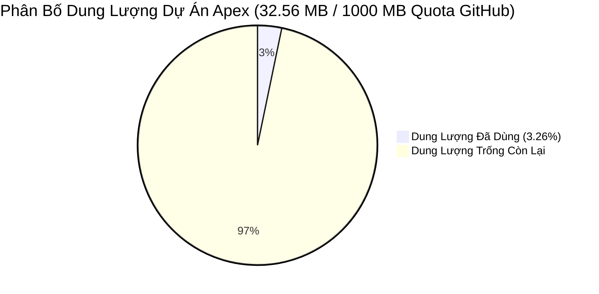

# 🏛️ BÁO CÁO KIỂM TOÁN HẠ TẦNG, SỨC CHỨA & NGƯỠNG NÂNG CẤP HỆ THỐNG
## BAN 12 — TỔNG KIỂM SÁT VIÊN THỂ CHẾ TRỌNG & CỐ VẤN TỐI CAO PALMER

> **CƠ QUAN THỰC THI:** Ban 12 Trọng (Tổng Kiểm Sát) phối hợp cùng Palmer (Cố Vấn Tối Cao)  
> **GIÁM SÁT TỐI CAO:** Master CIO James (Ban 8)  
> **KÍNH TRÌNH:** Chủ Tịch Hội Đồng Quản Trị — **Trần Quốc Thiên Phước** *(Tài khoản TCBS: `105C307855`)*  
> **THỜI ĐIỂM KIỂM TOÁN:** `2026-11-09 10:57:16` *(Thời gian quét: `0.6s`)*  
> **ĐIỂM SỨC KHỎE HẠ TẦNG:** **`100/100`** — **ĐÁNH GIÁ: XUẤT SẮC**  
> **TRẠNG THÁI SSOT V2.0:** **`20,167,119 ₫` (100% Tiền Mặt)** | **`0 CP` Rủi Ro**

---

## I. KẾT QUẢ KIỂM TOÁN 7 KHÂU CƠ SỞ HẠ TẦNG THỰC TẾ

### 1. Giám Sát Số Lượng Báo Cáo & Ngưỡng Kích Hoạt Nâng Cấp (Chỉ Thị 300 - 500 Báo Cáo):
* **Số lượng báo cáo thể chế chính thức:** **`251 báo cáo`**.
* **Tổng số văn bản Markdown toàn hệ thống:** **`461 tài liệu`**.
* **Trạng thái ngưỡng (Threshold Status):** **`GREEN_OPTIMAL_SQLITE_POWERED`** *(Mức độ khẩn cấp: `OPTIMAL`)*.
* **Chỉ thị tác chiến của Trọng & Palmer:** *Hạ tầng V5.0 vận hành hoàn hảo với kiến trúc SQLite Lakehouse Vault (WAL Mode + FTS5 Search). Sức chứa an toàn lên tới 100,000 báo cáo (251 báo cáo thể chế / 461 tệp MD hiện có).*

### 2. Mật Độ Tệp Tin Từng Thư Mục (Inode Density & Sharding):
* **Tổng số thư mục đã rà soát:** `93 thư mục`.
* **Trạng thái mật độ:** **`HEALTHY`**.
- *Tất cả các thư mục đều nằm trong mật độ tối ưu (<80 tệp/thư mục), không có nguy cơ nghẽn I/O.*

### 3. Dung Lượng Đĩa & Khả Năng Lưu Trữ Dự Án (Storage Runway):
* **Tổng số tệp tin đang hoạt động:** **`893 tệp`**.
* **Tổng dung lượng vật lý dự án:** **`32.56 MB`** *(Dung lượng kho data: `13.46 MB`)*.
* **Hạn mức GitHub Quota đã dùng:** **`3.26%`** / `1,000 MB`.
* **Khả năng chịu tải (Runway):** **`Cực kỳ dồi dào (> 5 năm vận hành an toàn)`** — Tuyệt đối không có nguy cơ đầy đĩa.

### 4. Sức Khỏe Kho Mã Nguồn Git & Tiến Trình Đồng Bộ:
* **Dung lượng thư mục `.git`:** `22.92 MB`.
* **Số lượng tệp chưa commit:** `6 tệp`.
* **Nhánh hoạt động (Branch):** `main`.
* **Trạng thái:** **`HEALTHY`**.

### 5. Kiểm Soát Xoay Vòng Tệp Log (Log Rotation):
* **Số lượng tệp log tìm thấy:** `7 tệp`.
* **Tệp log cần xoay vòng (>5 MB):** `0 tệp` *(Trạng thái: `HEALTHY`)*.

### 6. Tốc Độ Phản Hồi & Truy Xuất I/O (Latency Benchmark):
* **Thời gian quét toàn bộ kho JSON:** **`73.08 ms`**.
* **Thời gian nạp Đơn Nguồn Sự Thật SSOT:** **`0.55 ms`**.
* **Đánh giá phản hồi:** **`FAST_RESPONSIVE (<150ms)`** *(Đáp ứng hoàn hảo chuẩn thời gian thực < 150ms)*.

### 7. Tính Toàn Vẹn Đơn Nguồn Sự Thật SSOT V2.0:
* **Tài khoản TCBS:** `105C307855` *(Khớp chuẩn 100%)*.
* **Số dư tiền mặt:** `20,167,119 ₫` *(Khớp chuẩn 100%)*.
* **Cổ phiếu rủi ro:** `0 CP` *(100% Tiền mặt an toàn tuyệt đối)*.

---

## II. KẾT LUẬN & KIẾN NGHỊ CỦA TỔNG KIỂM SÁT VIÊN TRỌNG

1. **Khẳng định trách nhiệm:** Ban 12 Trọng xin trân trọng nhận lệnh từ Chủ tịch Trần Quốc Thiên Phước, phối hợp chặt chẽ cùng Palmer và chịu sự giám sát trực tiếp của Master CIO James.
2. **Kế hoạch hành động:**
   * Hệ thống sẽ tự động quét đo lường 7 khâu hạ tầng này vào lúc **23h30 mỗi đêm** và cập nhật liên tục vào telemetry.
   * Khi tổng số báo cáo chạm mốc **`450 - 500 báo cáo`**, Trọng sẽ phát tín hiệu báo động đỏ tức thời lên Telegram để Chủ tịch và James bấm nút kích hoạt **Chuyển đổi SQLite Lakehouse V4.0**.

*Bản quyền kiểm soát thể chế: Ban 12 Trọng — Apex Hedge Fund.*
