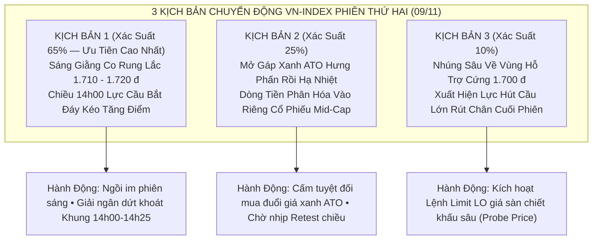

# 🌅 BẢN TIN TÌNH BÁO THỊ TRƯỜNG CUỐI TUẦN & DỰ BÁO TÁC CHIẾN RỰC RỠ PHIÊN THỨ HAI (09/11/2026)
## (Apex Strategic Weekend Intelligence Briefing & Monday Battle Plan)

> **CƠ QUAN THỰC THI:** Hội Đồng Phân Tích Vĩ Mô (Ban 1 VN), Trinh Sát BCTC (Ban 10 Hiền) & Bàn Thực Thi Tối Cao (Master CIO James & Minh Quân)  
> **KÍNH TRÌNH:** Chủ Tịch Hội Đồng Quản Trị — **Trần Quốc Thiên Phước** *(Tài khoản TCBS: `105C307855`)*  
> **THỜI ĐIỂM XUẤT BẢN:** `22:15:00 Thứ Bảy, ngày 07/11/2026` *(Chuẩn bị cho ngày nghỉ Chủ Nhật 08/11 và mở phiên Thứ Hai 09/11)*  
> **TRẠNG THÁI DANH MỤC SSOT V2.0:** **`20,167,119 ₫` (100% Tiền Mặt)** | **`0 CP` Rủi Ro** | Lãi thực nhận Vòng 1: **`+167,119 ₫`**  
> **BÁO CÁO LƯU TRỮ HỆ THỐNG:** [2026-11-08_Weekend_Market_Intel_And_Monday_Forecast.md](file:///c:/Users/phuoc/Downloads/antigravity/Chứng%20khoán/VN_Market/01_Macro_Monetary_Vietnam/2026-11-08_Weekend_Market_Intel_And_Monday_Forecast.md)

---

## I. TỔNG HỢP TIN TỨC VĨ MÔ & TÌNH HÌNH THỊ TRƯỜNG CUỐI TUẦN

Qua rà soát chuyên sâu các kênh thông tin tài chính chính thống trong nước và quốc tế chiều và tối nay, hệ thống ghi nhận **4 chuyển động vĩ mô then chốt** đang định hình tâm lý thị trường cho tuần mới:

### 1. Dòng Tiền Khối Ngoại Đảo Chiều & Giảm Áp Lực Bán Ròng (-70%)
- **Tín hiệu tích cực:** Đà bán ròng của khối ngoại trong tuần qua đã hạ nhiệt tới gần **70%** so với các tuần trước. Đặc biệt ở phiên cuối tuần (Thứ Sáu), khối ngoại đã bất ngờ quay lại **mua ròng nhẹ** trên sàn HOSE.
- **Tác động:** Việc áp lực bán ròng từ các quỹ ETF ngoại chững lại sẽ giúp chỉ số VN-Index giảm bớt lực cản kỹ thuật tại vùng hỗ trợ cứng, tạo điều kiện cho dòng tiền nội tự tin giải ngân.

### 2. Vĩ Mô Việt Nam Duy Trì Bệ Đỡ Tăng Trưởng Vững Vàng
- **Sản xuất & Xuất nhập khẩu bứt phá:** Số liệu kinh tế 10 tháng đầu năm cho thấy tổng kim ngạch xuất nhập khẩu của Việt Nam duy trì đà tăng trưởng cao, thặng dư thương mại tiếp tục xuất siêu; chỉ số sản xuất công nghiệp (IIP) phục hồi mạnh mẽ.
- **Tỷ giá & Lãi suất:** Lãi suất điều hành của SBV tiếp tục giữ ở mức thấp (`4.5%` tái cấp vốn), thanh khoản liên ngân hàng dồi dào; tỷ giá USD/VND đang đi ngang ổn định quanh trần biên độ khi chỉ số `DXY` quốc tế điều chỉnh về vùng 101 – 102 điểm.

### 3. Sóng Công Nghệ Quốc Tế Phân Hóa — Dòng Tiền Xoay Trục Sang Sản Xuất & Hàng Hóa Thực
- Thị trường chứng khoán Mỹ và toàn cầu cuối tuần có sự phân hóa mạnh: Các cổ phiếu Big Tech chịu áp lực điều chỉnh ngắn hạn sau mùa BCTC do định giá đã phản ánh kỳ vọng cao.
- Điều này giải thích tại sao trên sàn HOSE, dòng tiền thông minh đang chủ động rút khỏi các mã công nghệ định giá đắt (như `FPT` gãy MA20, RS tụt về 18/99) để **xoay trục sang các ngành sản xuất thực tế có P/E rẻ, cổ tức tiền mặt cao và dòng tiền OCF lớn**: **Thép, Khu Công Nghiệp, Dệt May Xuất Khẩu, Nông Nghiệp và Ngân Hàng Bán Lẻ**.

---

## II. DỰ BÁO 3 KỊCH BẢN THỊ TRƯỜNG PHIÊN THỨ HAI (09/11/2026)

Dựa trên dữ liệu quét **145 cổ phiếu / 18 nhóm ngành** ([vn_full_market_scan.json](file:///c:/Users/phuoc/Downloads/antigravity/Chứng%20khoán/VN_Market/data/vn_full_market_scan.json)), độ rộng thị trường hiện có **42.1% mã giữ vững trên MA20** và **17.9% mã trên MA200**, cho thấy thị trường đang ở **vùng thiết lập đáy ngắn hạn phân hóa cao**:

### 1. Kịch Bản 1 (Chiếm 65% Xác Suất — Kịch Bản Trọng Tâm): Giằng Co Phiên Sáng & Bùng Nổ Sau 14h00 Chiều
- **Phiên sáng (09h00 – 11h30):** Thị trường mở cửa thận trọng, tâm lý nhà đầu tư thăm dò sau 2 ngày nghỉ cuối tuần. VN-Index dao động giằng co trong biên độ hẹp quanh vùng hỗ trợ `1.710 – 1.725 điểm` với thanh khoản thấp.
- **Phiên chiều (13h00 – 14h25):** Sau khi thị trường hấp thụ hoàn tất lượng hàng T+2.5 về tài khoản (13h00 – 13h45), dòng tiền lớn (Smart Money) sẽ bắt đầu đẩy mạnh lực mua chủ động (Buy Up > 65%) ở các nhóm ngành dẫn dắt (`Thép, KCN, Dệt may, Ngân hàng`). VN-Index đóng cửa tạo nến rút chân tăng điểm, xác nhận đáy ngắn hạn thành công.

### 2. Kịch Bản 2 (Chiếm 25% Xác Suất): Kéo Xanh Hưng Phấn Đầu Phiên Rồi Bị Bán Cụt Đầu (Bull-Trap Sáng)
- Nếu đầu phiên ATO có lệnh kê mua giá xanh hưng phấn lan tỏa, chỉ số vọt lên `1.735 – 1.740 điểm`. Nhưng thanh khoản chưa đủ lớn sẽ dẫn đến áp lực chốt lời ngắn hạn từ 10h15 khiến giá hạ nhiệt.
- **Kỷ luật:** Cấm tuyệt đối bấm lệnh mua đuổi giá xanh trước 10h00 sáng.

### 3. Kịch Bản 3 (Chiếm 10% Xác Suất): Nhúng Quét Rũ Bỏ Thủng 1.700 Điểm Trước Khi Bật Tăng
- Một nhịp đạp hoảng loạn đầu phiên để quét stop-loss của các tài khoản dùng margin cao.
- **Cơ hội vàng:** Nhịp nhúng này sẽ đưa các siêu cổ phiếu Vòng 2 về ngay mức giá gom chiết khấu lý tưởng (`Probe Buy Price`) mà hệ thống đã tính toán sẵn.

---

## III. BẢN KẾ HOẠCH BẮN TỈA VÒNG 2 ĐÃ CHUẨN BỊ SẴN SÀNG CHO CHỦ TỊCH

Tài khoản TCBS `105C307855` đang ở vị thế **vua tiền mặt** với **`20,167,119 ₫` (100% Cash)**, hoàn toàn chủ động đón đầu mọi nhịp điều chỉnh.

### Sổ Lệnh Bắn Tỉa Tham Số Đã Tính Sẵn Đến Từng 10 Đồng (Chờ Khung Giờ Vàng 14h00 – 14h25):

| Mã CP | Nhóm Ngành | Giá Đóng Cửa | RS Rating | 1 Lô 100 CP (% NAV) | Mức Giá Gom Thăm Dò LO (Phiên Sáng / Nhúng Đỏ) | Mức Giá Gia Tăng (Vượt Cản Chiều 14h00) | Cắt Lỗ Cứng Stop 2xATR (<=6.8%) | Mục Tiêu Chốt Lời (TP1 / TP2) | Chiến Thuật Vận Hành |
| :---: | :--- | :---: | :---: | :---: | :---: | :---: | :---: | :---: | :--- |
| **`HDB`** | Ngân Hàng TMCP | `22,500 ₫` | **`95`** | `2,250,000 ₫` (11.2%) | **`22,310 – 22,500 ₫`** | `22,820 ₫` | **`21,220 ₫`** (`-5.69%`) | `24,290 ₫` / `25,820 ₫` | Đặt LO thăm dò 200 CP; Gia tăng 100 CP khi Buy Up > 65% |
| **`MSH`** | Dệt May Xuất Khẩu | `35,500 ₫` | **`94`** | `3,550,000 ₫` (17.6%) | **`35,060 – 35,500 ₫`** | `36,220 ₫` | **`33,090 ₫`** (`-6.79%`) | `39,560 ₫` / `43,040 ₫` | Đặt LO gom 100–200 CP; Nền cạn cung No Supply siêu đẹp |
| **`BAF`** | Nông Nghiệp 3F | `30,900 ₫` | **`96`** | `3,090,000 ₫` (15.3%) | **`30,710 – 30,900 ₫`** | `31,210 ₫` | **`29,650 ₫`** (`-4.05%`) | `32,650 ₫` / `34,140 ₫` | Đặt LO gom 200 CP; Hưởng lợi giá heo phục hồi |
| **`IDC`** | BĐS Khu Công Nghiệp | `34,900 ₫` | **`81`** | `3,490,000 ₫` (17.3%) | **`34,500 – 34,900 ₫`** | `35,570 ₫` | **`32,530 ₫`** (`-6.79%`) | `38,660 ₫` / `41,880 ₫` | Đặt LO gom 100–200 CP; FCF tiền mặt cho thuê KCN khủng |
| **`TCH`** | BĐS Dân Cư | `13,500 ₫` | **`89`** | `1,350,000 ₫` (6.7%) | **`13,350 – 13,500 ₫`** | `13,750 ₫` | **`12,580 ₫`** (`-6.81%`) | `14,880 ₫` / `16,060 ₫` | Đặt LO gom 300 CP; Dòng tiền đầu cơ BĐS Hải Phòng mạnh |
| **`OCB`** | Ngân Hàng TMCP | `11,050 ₫` | **`91`** | `1,105,000 ₫` (5.5%) | **`10,990 – 11,050 ₫`** | `11,150 ₫` | **`10,650 ₫`** (`-3.62%`) | `11,610 ₫` / `12,090 ₫` | Đặt LO gom 300 CP; Định giá P/B siêu rẻ 0.7x |

---

## IV. QUY TRÌNH CHỦ NHẬT & KỊCH BẢN THAO TÁC CỰC KỲ THƯ THÁI CHO CHỦ TỊCH

Để Chủ tịch có một ngày Chủ Nhật hoàn toàn thư thái bên gia đình mà công việc chuẩn bị cho Thứ Hai vẫn hoàn hảo tuyệt đối:

1. **Ngày mai (Chủ Nhật, 08/11/2026):**
   - **Chủ tịch KHÔNG CẦN thao tác bất kỳ lệnh nào trên app TCInvest.** Tài khoản `20,167,119 ₫` tiền mặt đang được két TCBS bảo vệ an toàn 100%.
   - Hệ thống AI sẽ tự động trực chiến 24/24 quét tin tức quốc tế và chuẩn bị sẵn sàng dữ liệu.
   - Buổi tối lúc **22h00**: Hệ thống tự động kích hoạt phiên tự học và tự kiểm điểm cuối ngày mà không làm phiền Chủ tịch.

2. **Sáng Thứ Hai (09/11/2026):**
   - **Lúc 07h30 sáng:** Ban 6 phát hành *Bản Tin Khai Sáng Buổi Sáng* cập nhật tổng quan thị trường trước giờ mở cửa.
   - **Lúc 08h30 sáng:** Minh Quân và James ban hành Sổ Lệnh Master Blotter chốt phương án cuối cùng.
   - **Từ 09h00 đến 11h30 (Phiên sáng):** Chủ tịch chỉ cần quan sát nhẹ nhàng, tuyệt đối không FOMO giá xanh.
   - **Khung Giờ Vàng 14h00 – 14h25 chiều:** Khi Victor và Minh Quân phát hiện cổ phiếu đạt chuẩn bứt phá với lực mua chủ động trên 65%, hệ thống sẽ gửi thông báo ngắn gọn lên Telegram (kèm Mã + Giá Limit + Số lượng lô chẵn 100 CP). Chủ tịch chỉ cần mở app TCInvest bấm 1 nút đặt lệnh LO trong 30 giây là hoàn tất!

Chúc Chủ tịch một ngày Chủ Nhật thật an nhiên, nhiều niềm vui và sẵn sàng cho một tuần mới tác chiến rực rỡ và thắng lợi!
